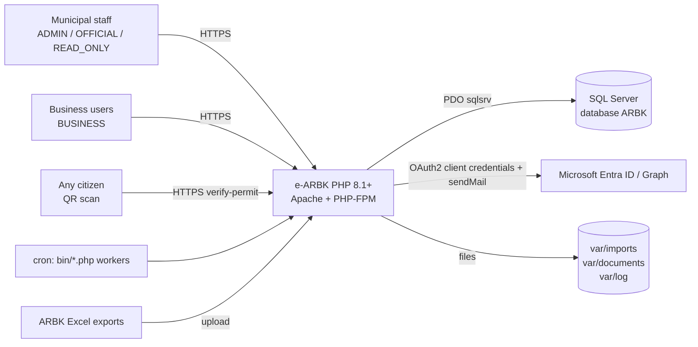
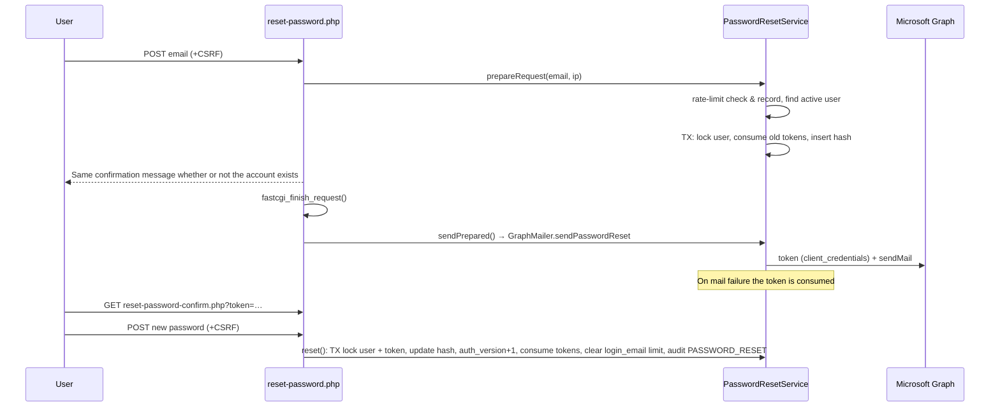
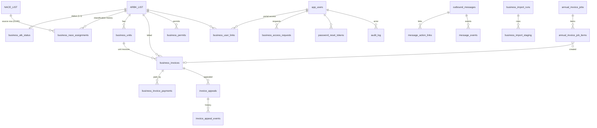
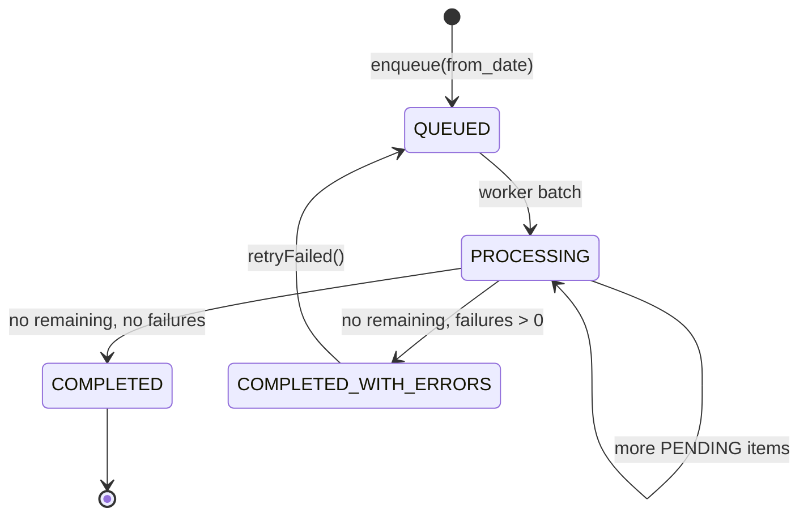
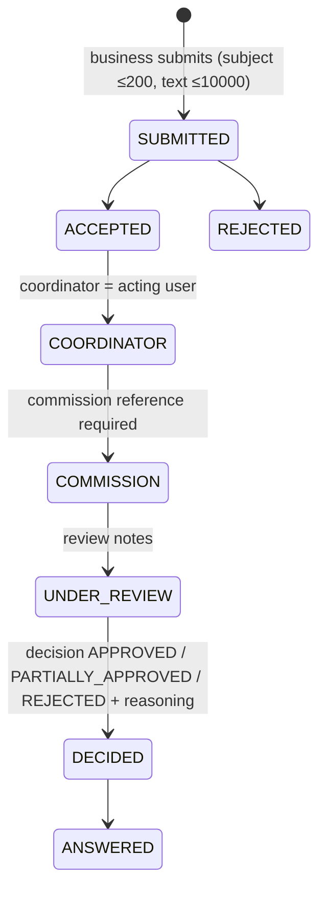

# e-ARBK — Low Level Design (LLD)

**System:** Tarifat e bizneseve (Business Tariff Administration), Komuna e Prishtinës
**Repository:** `brahaluftar/e-arbk`, branch `main`
**Baseline:** commit `b958c45` (2026-10-16), "Add business unit imports contacts and billing", 25 migrations (`0001`–`0025`)
**Document date:** 2026-10-22
**Status:** Reference baseline for upgrade versions, user manuals and installation packages

> Use this document as the single technical reference. Sections 1–14 describe the system **as it is now** and were checked against the source code. Sections 15–18 are **proposals**: bug fixes, simplification, and a UI/responsive redesign. Every bug in section 15 has a source location so you can verify it before you fix it.

---

## Table of contents

1. [Purpose, audience and conventions](#1-purpose-audience-and-conventions)
2. [Glossary](#2-glossary)
3. [System overview](#3-system-overview)
4. [Architecture](#4-architecture)
5. [Configuration reference](#5-configuration-reference)
6. [Security design](#6-security-design)
7. [Data model](#7-data-model)
8. [Module designs](#8-module-designs)
9. [Endpoint catalogue](#9-endpoint-catalogue)
10. [User interface and styles](#10-user-interface-and-styles)
11. [Generated documents (PDF, XLSX, email)](#11-generated-documents-pdf-xlsx-email)
12. [CLI commands and scheduling](#12-cli-commands-and-scheduling)
13. [Installation, deployment and upgrade](#13-installation-deployment-and-upgrade)
14. [Testing, operations and diagnostics](#14-testing-operations-and-diagnostics)
15. [Proposal A — Bug fixes](#15-proposal-a--bug-fixes)
16. [Proposal B — Simplifying functions and features](#16-proposal-b--simplifying-functions-and-features)
17. [Proposal C — Simplified, fully responsive UI](#17-proposal-c--simplified-fully-responsive-ui)
18. [Upgrade roadmap](#18-upgrade-roadmap)
19. [Appendices](#19-appendices)

---

## 1. Purpose, audience and conventions

| Audience | Use this document for |
| --- | --- |
| Developers preparing an upgrade | Class and method contracts, SQL rules, data model, bug and refactor backlog (sections 4–9, 15–18) |
| Technical writers (user manuals) | Roles, screens, workflows, field labels, messages (sections 6.3, 8, 10, 19.4) |
| Operators and installers | Requirements, configuration, deployment, cron, backups, health checks (sections 5, 12, 13, 14) |

**Conventions**

- File references use `path:line`. Many source files keep a whole method on one line, so a line number often points to a full method.
- The UI language is Albanian. Labels are quoted exactly as they appear on screen, for example **"Bizneset"**, with an English gloss where it helps.
- "Staff" means the roles `ADMIN`, `OFFICIAL` and `READ_ONLY`. "Business user" means role `BUSINESS`.
- Monetary values are EUR with `decimal(18,2)` precision unless noted otherwise.
- All timestamps written by the database are UTC (`SYSUTCDATETIME()`). PHP formats dates in `APP_TIMEZONE`.

---

## 2. Glossary

| Term | Meaning |
| --- | --- |
| **ARBK** | Kosovo Business Registration Agency. Its register is stored in the legacy table `dbo.ARBK_LIST`. |
| **ATK** | Tax Administration of Kosovo. The legacy table `dbo.ATK_LIST` holds closed or deactivated businesses. |
| **NRBIZ / NRB** | Unique business registration number (`ARBK_LIST.NRBIZ`, `ATK_LIST.NRB`). |
| **NACE** | EU activity classification. `NACE_CODE_REG` is the 4-digit code registered at ARBK. |
| **NACE_LIST** | Municipal tariff catalogue: a NACE code can have several rows (sector + activity + `Tarifa`). |
| **Klasifikimi** | Assigning one `NACE_LIST` row (category and tariff) to a business. It is either `AUTO` or `MANUAL`. |
| **Tarifa me lirim** | Discounted tariff (`tarifa_me_lirim`) for women- or veteran-owned businesses. It is entered manually. |
| **Pasiv** | Passive status, imported as `Pasiv-DD/MM/YYYY`. |
| **Shuar** | Closed or dissolved business (from the "closed businesses" import). |
| **Njësi / degë** | Business unit or branch (`business_units`), invoiced separately. |
| **UNIREF** | 16-character payment reference: `PREAH` + 4-character NACE + 6-digit sequence + mod-36 check character. |
| **Leje pune** | Work permit PDF with a public QR verification link. |
| **Ankesë** | Appeal against an invoice. It follows a multi-step workflow. |
| **Job** | A background annual-invoice generation run (`annual_invoice_jobs`). |

---

## 3. System overview

### 3.1 Purpose

The application helps the municipality to:

1. Keep a normalized copy of the ARBK register for Prishtina, filled from Excel imports.
2. Find deactivated businesses by matching them against ATK data.
3. Classify each business to a municipal NACE tariff category, automatically or manually.
4. Estimate, issue, track and collect annual business tariffs: invoices, UNIREF, payments, PDFs and email.
5. Run a self-service portal where businesses see their invoices and permits and submit appeals.
6. Issue work permits with public QR verification.
7. Administer staff users, audit every change, and report on outbound email.

### 3.2 Context diagram



### 3.3 Technology stack

| Concern | Technology |
| --- | --- |
| Language/runtime | PHP ≥ 8.1, `declare(strict_types=1)` everywhere, no framework |
| Autoloading | Composer PSR-4, `App\` → `src/` |
| Database | Microsoft SQL Server (compatibility level ≥ 130 for `OPENJSON`), `pdo_sqlsrv` |
| Web server | Apache 2.4 with `mod_rewrite`, PHP-FPM (`proxy:unix:/var/run/php/php8.1-fpm.sock`) |
| PDF | `setasign/fpdf` ^1.8.6, `setasign/fpdi` ^2.6 (merging) |
| QR codes | `endroid/qr-code` ^5.0 (PNG) |
| XLSX | Custom streaming reader (`XMLReader` + `ZipArchive`) and writer (`XMLWriter`) |
| Email | Microsoft Graph `sendMail`, app-only `Mail.Send`, through `file_get_contents` stream context |
| Front-end | Server-rendered PHP templates and 3 CSS files. **No JavaScript.** The strict CSP blocks inline script. |
| Tests | PHPUnit ^10.5 (unit tests with mocked PDO) |

**Required PHP extensions:** `pdo`, `pdo_sqlsrv`, `mbstring`, `openssl`, `gd`, `zip`, `xmlreader`, `xmlwriter`, `simplexml`, `zlib`. `allow_url_fopen=On` is required for Graph email.

---

## 4. Architecture

### 4.1 Directory layout

```
e-arbk/
├── bootstrap.php            Web/CLI bootstrap: config, headers, HTTPS, session, PDO, helpers
├── index.php, .htaccess     Root entry used when the project root is the web root (dev)
├── composer.json/.lock
├── config/defaults.php      Default configuration values (see §5)
├── public/                  Production document root
│   ├── .htaccess            Pretty-URL rewrites
│   ├── index.php            Redirect to landing page
│   ├── health.php           JSON health check
│   ├── message-action.php   Tracked email link redirector
│   ├── verify-permit.php    Public permit verification
│   ├── logo_prishtina.png
│   ├── assets/{app,dashboard,finance}.css
│   ├── auth/                login, logout, reset-password(+confirm), register-business
│   ├── admin/               Staff controllers (dashboard, businesses, finance, imports, users,
│   │                        business-access, appeals, permits, messages)
│   └── portal/              Business portal controllers
├── templates/               PHP view templates + layout.php
├── src/
│   ├── Billing/             Annual invoice job, UNIREF, invoice PDF, job artifacts
│   ├── Deployment/          DatabaseTransfer (snapshot export/import/verify)
│   ├── Document/            DocumentStore, JobArtifactStore, PdfText trait
│   ├── Export/              XlsxWriter
│   ├── Import/              XlsxRowReader, BusinessImportNormalizer, BusinessImportService
│   ├── Infrastructure/Database/ConnectionFactory
│   ├── Permitting/          PermitService, PermitPdfRenderer, PublicPermitToken, VerificationQrRenderer
│   ├── Repository/          BusinessRepository, PortalRepository
│   ├── Security/            Auth, Csrf, LoginRateLimiter, PasswordResetService, BusinessRegistrationService
│   ├── Service/             Audit, users, classification, ATK, tariff mapping, edit, units, ledger,
│   │                        access, appeals, Graph mailer, tracked messages
│   └── Support/             Config, ProductionValidator
├── bin/                     CLI commands and workers (§12)
├── database/
│   ├── migrations/          0001–0025, applied in file-name order
│   ├── manual/              One-off operator scripts
│   └── diagnostics/         Read-only diagnostics
├── deploy/                  Packaging (PowerShell), deployment (bash), Apache vhost, cron
├── docs/                    Operational documentation
├── tests/                   PHPUnit tests
└── var/{imports,documents,log}/   Runtime storage (symlinked to shared/ in production)
```

### 4.2 Layering

```mermaid
flowchart TD
    R[public/*.php controllers<br/>auth guard + CSRF + input parsing] --> S[src/Service, src/Billing, src/Permitting,<br/>src/Security, src/Import]
    R --> Q[src/Repository<br/>read models]
    R --> T[templates/*.php via render()]
    S --> A[AuditLogger]
    S --> DB[(PDO / SQL Server)]
    Q --> DB
    S --> D[DocumentStore / JobArtifactStore]
    S --> M[GraphMailer]
    C[bin/*.php CLI] --> S
```

- **Controllers** are physical PHP files. Each one does: `require bootstrap.php` → guard (`requireUser` / `requireRole` / `requireBusiness`) → for POST, check the method and verify CSRF → call a service → `flash()` → `redirect()`, or `render()` a template.
- **Services** own their transactions. They throw `DomainException` with an Albanian message for user errors. Controllers show that message as an error flash. Any other `Throwable` is logged with `error_log()` and replaced by a generic message.
- **Repositories** hold read-only SQL for lists and dashboards.
- Some **direct SQL in controllers** remains, for example business-access, appeals, imports, messages, users, bulk-pdf, email-invoice and verify-permit.

### 4.3 Request lifecycle (`bootstrap.php`)

1. Load `vendor/autoload.php`. If it is missing, return HTTP 503 "Run composer install first."
2. `Config::load()` merges `config/defaults.php`, then the env file, then process environment variables (§5.1).
3. `ProductionValidator::enforce()` throws if `APP_ENV=production` and any rule fails (§5.3).
4. Set the timezone (`APP_TIMEZONE`) and `display_errors=0`, `log_errors=1`.
5. Send security headers: `X-Content-Type-Options: nosniff`, `X-Frame-Options: DENY`, `Referrer-Policy: same-origin`, and the CSP `default-src 'self'; img-src 'self' data:; style-src 'self'; form-action 'self'; frame-ancestors 'none'; base-uri 'self'`.
6. HTTPS enforcement: when `FORCE_HTTPS` is on and the request is not HTTPS (`$_SERVER['HTTPS']`, or `X-Forwarded-Proto` when `TRUST_PROXY_HEADERS`), GET/HEAD get a 308 redirect to `APP_URL` + URI. Other methods get HTTP 400.
7. Session: strict mode, HttpOnly, `SameSite=Lax`, `Secure` when HTTPS, name `APP_SESSION_NAME`.
8. Create the PDO connection (`ConnectionFactory`) and the `Auth` and `Csrf` objects.
9. Return `compact('root','config','pdo','auth','csrf')` as `$app`.

**Global helper functions**

| Function | Behaviour |
| --- | --- |
| `app_url(string $path)` | Prefixes the path with the base path taken from `APP_URL` (for example `/arbk`) |
| `e(mixed $v)` | `htmlspecialchars(..., ENT_QUOTES\|ENT_SUBSTITUTE, 'UTF-8')` |
| `redirect(string $path): never` | `Location: app_url($path)`, then exit |
| `flash($type, $message)` / `take_flashes()` | Session flash queue. Types: `success`, `error`, `info` |
| `request_ip()` | First `X-Forwarded-For` IP when `TRUST_PROXY_HEADERS`, otherwise `REMOTE_ADDR` |
| `business_list_path($query)` | Whitelists list filters (`q,nace,classification,atk_status,pronare_grua,pronar_veteran,page`) for safe "return to list" links |
| `render($template,$title,$view)` | Extracts `$view` (EXTR_SKIP), sets `$user`, `$flashes`, `$csrf`, and includes `templates/layout.php`, which includes the template |

### 4.4 Routing

The app uses physical routes: the URL path equals the PHP file under `public/`. Pretty URLs from `public/.htaccess`:

| Pretty URL | Target |
| --- | --- |
| `/` | `admin/dashboard.php` |
| `/admin/dashboard` | `admin/dashboard.php` |
| `/admin/businesses` | `admin/businesses/index.php` |
| `/admin/businesses/classification` | `admin/businesses/classification.php` |
| `/admin/businesses/{id}` | `admin/businesses/view.php?id={id}` |

The root `.htaccess` (used when the project root is served, for example `http://localhost/arbk`) denies `bin|config|database|deploy|docs|src|templates|tests|var|vendor` and dotfiles. It maps `admin/*.php`, `auth/*`, `assets/*` and `health.php` into `public/`. It does **not** map `portal/`, `message-action.php`, `verify-permit.php` or the logo (bug B-26).

### 4.5 Background processing

| Queue | Table | Producer | Consumer | Claim mechanism |
| --- | --- | --- | --- | --- |
| Excel imports | `business_import_runs` (`QUEUED→PROCESSING→COMPLETED/FAILED`) | `admin/imports/upload.php` | `bin/process-imports.php` (every minute), also one run per `bin/run-scheduled.php` | `UPDATE … WITH(UPDLOCK,READPAST,ROWLOCK) … OUTPUT inserted.*` on the oldest QUEUED row |
| Annual invoices | `annual_invoice_jobs` + `annual_invoice_job_items` | `admin/finance/generate-annual.php` | `bin/process-annual-invoices.php` (every minute, `flock`) | Per item: `UPDATE … SET status='PROCESSING' WHERE status='PENDING'` inside a transaction |
| Job artifacts (PDF + XLSX) | `annual_invoice_jobs.artifact_status` (`PENDING→BUILDING→READY/FAILED`) | Job completion | `bin/process-annual-invoices.php` | `UPDATE … READPAST … OUTPUT` |
| Sync/classify | n/a | cron | `bin/run-scheduled.php` every 15 minutes (`flock` on a temp lock file) | n/a |

---

## 5. Configuration reference

### 5.1 Loading precedence (`src/Support/Config.php`)

1. Start from `config/defaults.php`.
2. Choose **one** env file:
   - If the `ARBK_ENV_FILE` process variable is set, use that file. A missing or unreadable file is fatal.
   - Otherwise, if the directory `/cloudclusters/arbk-env` exists, use `/cloudclusters/arbk-env/.env`. A missing file is fatal.
   - Otherwise use `<project root>/.env`, which is optional.
3. Parse `KEY=VALUE` lines. Keys must match `^[A-Z][A-Z0-9_]*$`. Values are trimmed of whitespace and quotes. `#` starts a comment.
4. For every **known** key (defaults ∪ file), a process environment variable with the same name wins.

Accessors: `string()`, `int()`, `bool()` (uses `FILTER_VALIDATE_BOOL`), and `basePath()` (the path of `APP_URL`).

### 5.2 Settings

| Key | Default | Description | Production rule |
| --- | --- | --- | --- |
| `APP_ENV` | `development` | `production` enables the validator | must be `production` |
| `APP_DEBUG` | `false` | Not used for output; validated only | must be false |
| `APP_URL` | `http://localhost/arbk` | Absolute base URL. Used for redirects, email links and QR URLs | `https://…`; deployment-check expects `https://arbk.kryeqyteti.net` |
| `APP_TIMEZONE` | `Europe/Warsaw` | PHP timezone (see B-30) | — |
| `APP_SESSION_NAME` | `arbk_admin` | Session cookie name | — |
| `APP_KEY` | empty | HMAC key for rate-limit dimensions | ≥ 32 characters, not `REPLACE_*` |
| `GRAPH_TENANT_ID` / `GRAPH_CLIENT_ID` / `GRAPH_CLIENT_SECRET` | empty | Entra app with Graph `Mail.Send` (application) | required |
| `GRAPH_SENDER_MAILBOX` | `no-reply@kryeqyteti.net` | Sender mailbox | valid email |
| `GRAPH_BASE_URL` | `https://graph.microsoft.com/v1.0` | Must be on the host `graph.microsoft.com` over https | enforced |
| `GRAPH_TIMEOUT_SECONDS` | `15` | HTTP timeout | 1–60 |
| `PASSWORD_RESET_TTL_SECONDS` | `1800` | Reset-token lifetime | 60–86400 |
| `FORCE_HTTPS` | `false` | Redirect to HTTPS | must be true |
| `TRUST_PROXY_HEADERS` | `false` | Trust `X-Forwarded-Proto/For` | enable only behind a trusted proxy |
| `DB_HOST` | `localhost\sql2025` | SQL Server host (`host,port` allowed) | required |
| `DB_NAME` | `ARBK` | Database | required |
| `DB_USER` / `DB_PASSWORD` | empty | SQL login | required |
| `DB_TRUSTED_CONNECTION` | `true` | Windows authentication (dev) | must be false |
| `DB_ENCRYPT` | `false` | TLS to SQL Server | must be true |
| `DB_TRUST_SERVER_CERTIFICATE` | `true` | Skip certificate validation | recommended false |
| `PAGE_SIZE` | `25` | Business list page size | — |
| `CSRF_TTL_SECONDS` | `7200` | CSRF token lifetime | — |
| `LOGIN_RATE_WINDOW_SECONDS` | `900` | Rate-limit window | — |
| `LOGIN_RATE_MAX_ATTEMPTS` | `5` | Failures before a block | — |
| `LOGIN_RATE_BLOCK_SECONDS` | `900` | Block duration | — |
| `BACKUP_MODE` | `managed` | `managed` (provider) or `sqlserver` (`BACKUP DATABASE`) | one of the two |
| `DB_BACKUP_PATH` | empty | Server-side backup directory | required for `sqlserver` |
| `IMPORT_MAX_BYTES` | `157286400` (150 MiB) | Upload size limit | — |
| `INVOICE_DUE_DAYS` | `30` | Days until the due date (clamped 0–365) | — |
| `ANNUAL_INVOICE_BATCH_SIZE` | `200` | Default worker batch size (1–1000) | — |
| `MUNICIPALITY_NAME` | `KOMUNA E PRISHTINËS` | Printed on PDFs | required |
| `MUNICIPALITY_ADDRESS` / `MUNICIPALITY_CONTACT` / `MUNICIPAL_BANK_ACCOUNT` | empty | Invoice footer (address, email/contact, IBAN) | required |
| `INVOICE_LEGAL_TEXT` | Albanian legal sentence | Invoice footer text | — |

Process-only variables: `ARBK_ENV_FILE` (explicit env file) and `ARBK_COMPLETION_FILE` (`migrate.php` and `preflight-production.php` write `complete` to it on success; `deploy.sh` uses it).

### 5.3 Production validator (`ProductionValidator::errors`)

The validator applies only when `APP_ENV=production`. It checks: https `APP_URL`; `FORCE_HTTPS`; a valid `APP_KEY`; `DB_TRUSTED_CONNECTION=false`; DB host/name/user/password present; Graph tenant/client/secret present; municipality name/address/contact/IBAN present; a valid sender email; Graph base URL; the timeout and TTL ranges; `allow_url_fopen` enabled; `DB_ENCRYPT=true`; `APP_DEBUG=false`; and a valid backup mode and path. **Every request fails** (an uncaught RuntimeException) when any rule fails. `health.php` then returns 503.

---

## 6. Security design

### 6.1 Authentication (`src/Security/Auth.php`)

- **Login:** look up `app_users` by `normalized_email = UPPER(trim(email))` with `is_active=1`, then `password_verify()`. On success: `session_regenerate_id(true)`, store `_auth_user_id` and `_auth_user_version` (`auth_version`), and update `last_login_at`.
- **Per-request check:** `user()` reloads the row on every call (role and active flag are always fresh). If the session's `auth_version` differs from the database, the session is revoked.
- `auth_version` is incremented only by a password **reset** (`PasswordResetService::reset`). An admin password change does **not** increment it (B-20).
- **Logout:** POST + CSRF, then clear the session and `session_destroy()`.
- **Landing page:** `BUSINESS` users go to `/portal/index.php`. Everyone else goes to `/admin/dashboard.php`.
- **Guards:** `requireUser()` redirects to login. `requireRole([...])` returns HTTP 403 "Access denied.". `requireBusiness()` = `requireRole(['BUSINESS'])`.

### 6.2 Passwords

- Length 12–72 **bytes** (bcrypt limit), checked by `mb_strlen ≥ 12` and `strlen ≤ 72`. Confirmation must match (`hash_equals` or `===`).
- Stored with `password_hash(PASSWORD_DEFAULT)`.
- `bin/create-admin.php` requires ≥ 12 characters.

### 6.3 Roles and permissions (as implemented)

| Capability | ADMIN | OFFICIAL | READ_ONLY | BUSINESS |
| --- | :-: | :-: | :-: | :-: |
| Dashboard (operational metrics) | ✔ | ✔ | ✔ | ⚠ reachable (B-02) |
| Dashboard financial summary | ✔ | — | — | — |
| Business list, classification list, detail, Excel export | ✔ | ✔ | ✔ | ⚠ reachable (B-02) |
| Edit business data, add/edit units, manual classification | ✔ | ✔ | — | — |
| Issue work permit | ✔ | ✔ | — | — |
| Business access: invite, bulk invite, approve/reject, link/unlink | ✔ | ✔ | — | — |
| Appeals workflow (staff side) | ✔ | ✔ | — | — |
| Generate a unit invoice from the detail page | ✔ | — | — | — |
| Finance (summary, manual invoice, payment, annual job, unit invoices, PDFs, email) | ✔ | — | — | — |
| Excel imports | ✔ | — | — | — |
| User administration | ✔ | — | — | — |
| Email reports | ✔ | — | — | — |
| Download any invoice PDF (`/portal/invoice-pdf.php`) | ✔ | ✔ | ✔ | own linked businesses only |
| Portal: my businesses, request access, invoices, permits, appeals | — | — | — | ✔ |

Navigation shown per role (`templates/layout.php`):

- **BUSINESS:** "Bizneset e mia", "Faturat", "Lejet e punës", "Ankesat".
- **Staff:** "Paneli", "Bizneset". **ADMIN/OFFICIAL** also see "Qasjet" and "Ankesat". **ADMIN** also sees "Financat", "Faturat", "Email raportet", "Importet" and "Përdoruesit".
- Every logged-in user sees their name and role, and a "Dil" (logout) button.

User-management rules (`UserManagementService::save`): only an active ADMIN may manage users; the email must be unique (case-insensitive); an admin cannot deactivate or demote themself; at least one active ADMIN must remain; optimistic concurrency uses `row_version` (a hidden `version` field). Roles that can be assigned in the UI: `OFFICIAL` (Zyrtar), `READ_ONLY` (Vetëm lexim), `ADMIN` (Administrator). `BUSINESS` accounts are created only through registration invites.

### 6.4 CSRF (`Csrf.php`)

One token per session: 32 random bytes, base64url, valid for `CSRF_TTL_SECONDS`. `token()` rotates the token after expiry. `verify()` uses `hash_equals`. Every state-changing endpoint requires POST plus `_csrf`. A failure returns HTTP 400 "Invalid request." (login and reset show a flash instead).

### 6.5 Rate limiting

- **Table:** `login_rate_limits(action_code, dimension_hash)`. `dimension_hash = HMAC-SHA256(value, APP_KEY)`; the fallback key is `development-only-rate-limit-key`.
- **Login** (`LoginRateLimiter`): dimensions `login_ip` and `login_email`. The request is blocked when either has `blocked_until > now`. A failure runs an atomic `MERGE` that resets the window after `LOGIN_RATE_WINDOW_SECONDS` and sets `blocked_until` when the attempts reach `LOGIN_RATE_MAX_ATTEMPTS`. A success deletes both rows. A failed login also sleeps 250 ms. A blocked request returns HTTP 429 with `Retry-After`.
- **Password-reset requests:** dimensions `reset_ip` and `reset_email`. Every request counts as an attempt.
- **Cleanup:** `run-scheduled.php` deletes rows not updated for 7 days.

### 6.6 Tokens

| Token | Format | Storage | Lifetime | Single-use |
| --- | --- | --- | --- | --- |
| Password reset | 32 random bytes, base64url (43 characters) | SHA-256 in `password_reset_tokens.token_hash` | `PASSWORD_RESET_TTL_SECONDS` | yes; a new request consumes older tokens |
| Registration invite | 43-character base64url | SHA-256 in `business_registration_invites` | 168 h (1–720) | yes (`consumed_at`) |
| Email action link | selector 16 hex + secret 43-character base64url | `message_action_links.selector` + SHA-256 | 30 days | no (counts opens) |
| Permit verification | `selector(16 hex).secret(64 hex)` | `business_permits.public_selector` + SHA-256 | permanent | n/a |

### 6.7 Password reset flow



### 6.8 Other controls

- Input is bound through PDO prepared statements with `ATTR_EMULATE_PREPARES=false`. Dynamic SQL fragments (columns, TOP N) come only from whitelists or integers.
- Output is escaped with `e()` in templates.
- Uploads must have an `.xlsx` extension, be a valid ZIP containing `[Content_Types].xml` and `xl/worksheets/sheet1.xml`, and expand to at most 1 GiB (zip-bomb guard). They are stored under a random name outside the web root and deduplicated by `(sha256, source_type)`.
- Documents are stored under random 48-hex names. Keys are regex-checked before path resolution (no path traversal).
- `bin/*.php` that matter for security check `PHP_SAPI`. All of `bin/` is denied by `.htaccess` in root-hosted mode.
- The audit log is append-only: `audit_log` with actor (`USER` or `SYSTEM`), action, entity, and JSON before/after/metadata (checked by `ISJSON`).

---

## 7. Data model

### 7.1 Entity-relationship overview



### 7.2 Legacy tables (they exist before migrations run)

The migrations **do not create** `ARBK_LIST`, `ATK_LIST` or `NACE_LIST`. A fresh environment needs the deployment snapshot (§13.4).

**`dbo.ARBK_LIST`**: the business master. Columns used by the application:

| Column | Type (as used) | Source | Meaning |
| --- | --- | --- | --- |
| `REGULATION_ID` | int; default `NEXT VALUE FOR dbo.arbk_regulation_id_seq` (0009); unique index (0004) | system | Business ID |
| `ARBKrowGUID` | uniqueidentifier | import `NEWID()` | Row GUID |
| `NRBIZ` | varchar | import | Registration number (match key) |
| `Emri`, `EMRI_TREGTAR` | nvarchar | import | Legal name, trade name |
| `Lloji`, `Qyteti`, `Statusi` (nvarchar(40)) | — | import | Type, city, ARBK status |
| `Pasiv` bit, `date_pasivizimit` date | 0012 | import, edit | Passive flag and date |
| `NACE_CODE_REG`, `NACEPERSHKRIMI`, `SEKTORI` | — | import | Registered NACE, description, sector |
| `NR_PUNETOREVE`, `MADHESIA`, `TOTAL_M`, `TOTAL_F` | int / nvarchar(40) | import, contacts import, edit | Employees, size, male/female totals |
| `Viti` (registration year), `MUAJI`, `DATA_SHUARJES` | — | import | Year/month, closure date |
| `ATK_MBYLLUR` bit, `ATK_DATEMBYLLJE` | — | legacy, import (passive), edit | Closed at ATK |
| `MENAXHERI`, `NUMRI_TELEFONIT` | 0024 | contacts import, edit | Manager, phone |
| `NUMRI_FISKAL`, `ADRESA`, `EMAIL` | 0016 | edit | Fiscal number, address, email |
| `NACE_CODE_TARIFF`, `nace_veprimtaria_tariff`, `NaceRowGuid` | legacy | tariff mapping, classification | Tariff relation |
| `NACE_REG_TARIFF` | float (0005) | external/legacy | Registered tariff (drives annual invoicing) |
| `pronare_grua`, `pronesia_grua`, `pronar_veteran`, `perqindja_veteran`, `tarifa_me_lirim` | 0007 (with CHECKs) | WOMEN import, edit | Discount eligibility |
| `import_updated_at` | datetime2 | import, edit | Last change |

**`dbo.ATK_LIST`**: `ID`, `NRB`, `Statusi`, `DataMbylljes`.
**`dbo.NACE_LIST`**: `REGULATIONID` (float, not unique), `NACErowGUID` (the stable identity of a category), `NACE_CODE`, `Sektori`, `Veprimtaria`, `Tarifa` (money).

### 7.3 Application tables

| Table | Key columns and constraints | Purpose |
| --- | --- | --- |
| `app_users` | `id` bigint identity; `normalized_email` UNIQUE; `role_code` ∈ {ADMIN, OFFICIAL, READ_ONLY, BUSINESS}; `is_active`; `auth_version` ≥ 0; `row_version` | Accounts |
| `business_atk_status` | PK `business_id`; `status_code` ∈ {ACTIVE, DEACTIVATED, NEEDS_REVIEW}; `matched_by`, `matched_value`, `atk_record_id`, `atk_status`, `deactivated_at`, `match_count` | Materialized ATK status |
| `business_nace_assignments` | `business_id`, `original_nace_code`, `nace_list_id` float, `mapping_key`, `source_nace_row_guid`, `source_sector`, `source_activity`, `nace_category`, `tariff_snapshot` money, `assignment_method` ∈ {AUTO, MANUAL}, `assigned_*`, `ended_*`; **unique filtered index: one active row (`ended_at IS NULL`) per business** | Classification history |
| `audit_log` | actor, action, entity, JSON columns (ISJSON checks), indexes by entity and by action | Audit trail |
| `login_rate_limits` | PK (`action_code`, `dimension_hash` binary(32)) | Rate limiting |
| `password_reset_tokens` | `token_hash` UNIQUE, `expires_at`, `consumed_at` | Password reset |
| `business_import_runs` | `source_type` ∈ {ALL, WOMEN, CLOSED, CONTACTS, UNITS}; `status` ∈ {QUEUED, PROCESSING, COMPLETED, FAILED}; UNIQUE (`file_sha256`, `source_type`); counters | Import queue |
| `business_import_staging` | PK (`import_run_id`, `source_row_number`); normalized columns + unit columns + `validation_error` | Import staging |
| `business_invoices` | `fiscal_year` 2000–2100; `invoice_number` UNIQUE; `amount > 0`; `due_on ≥ issued_on`; `uniref` char(16) filtered-unique, `LIKE 'PREAH%'`; `status_code` ∈ {ISSUED, PARTIALLY_PAID, PAID, CANCELLED}; period/billed_months; snapshots; `pdf_storage_key`; `emailed_at`; `business_unit_id` FK; **unique (`business_id`, `fiscal_year`) WHERE `business_unit_id IS NULL`**; **unique (`business_unit_id`, `fiscal_year`) WHERE NOT NULL** | Invoices |
| `business_invoice_payments` | `invoice_id` FK, `amount > 0`, `paid_on`, `reference`, `notes` | Payments |
| `invoice_uniref_sequences` | PK `nace_code` char(4); `last_value` 1–999999 | UNIREF counters |
| `business_user_links` | `user_id`, `business_id`; unique active link (`ended_at IS NULL`) | Portal access |
| `business_access_requests` | `status_code` ∈ {PENDING, APPROVED, REJECTED}; review consistency CHECK; unique PENDING per (user, business) | Access requests |
| `business_registration_invites` | `token_hash` UNIQUE, `expires_at`, `opened_at`, `consumed_at` | Invites |
| `invoice_appeals` | `status_code` ∈ {SUBMITTED, ACCEPTED, COORDINATOR, COMMISSION, UNDER_REVIEW, DECIDED, ANSWERED, REJECTED}; `decision_code` ∈ {APPROVED, PARTIALLY_APPROVED, REJECTED} | Appeals |
| `invoice_appeal_events` | `from_status`, `to_status`, `comment`, actor | Appeal history |
| `business_permits` | `serial_number` UNIQUE; `public_selector` UNIQUE; `status_code` ∈ {ACTIVE, EXPIRED, REVOKED}; `valid_until ≥ valid_from ≥ issued_on`; snapshots; `revoked_*` (not used yet) | Work permits |
| `outbound_messages` | `message_type`, recipient, subject, related entity, `status_code` ∈ {QUEUED, SENT, FAILED} | Email log |
| `message_action_links` | `selector` UNIQUE, `secret_hash`, `target_path`, `expires_at`, `first_opened_at`, `open_count`, `completed_at` | Tracked links |
| `message_events` | `event_code` ∈ {QUEUED, SENT, FAILED, LINK_OPENED, ACTION_COMPLETED}; `ip_hash`, `user_agent_hash` | Email events |
| `annual_invoice_jobs` | period, `fiscal_year = YEAR(period_start)`, `due_days`, `status_code` ∈ {QUEUED, PROCESSING, COMPLETED, COMPLETED_WITH_ERRORS, FAILED}, counters, `artifact_status` ∈ {PENDING, BUILDING, READY, FAILED}, `pdf_storage_key`, `xlsx_storage_key` | Annual jobs |
| `annual_invoice_job_items` | PK (`job_id`, `business_id`); `status_code` ∈ {PENDING, PROCESSING, CREATED, SKIPPED_EXISTING, SKIPPED_MISSING_TARIFF, SKIPPED_INVALID_NACE, FAILED}; `invoice_id`, `amount` | Job items |
| `business_units` | `business_id` FK; `unit_name`, `address` (required); `phone_number`, `email`, `manager_name`; `nace_code` varchar(20); `annual_tariff > 0` or NULL; `auto_invoice`; `is_active`; UNIQUE (`business_id`, `unit_name`, `address`) | Units/branches |
| `schema_migrations` | PK `migration` (file name), `applied_at` | Migration ledger |
| `deployment_imports` | Created by a snapshot import | Snapshot ledger |

**View `dbo.v_business_master`** (latest version from 0010) flattens business identity, ARBK fields, tariff relation, discount fields, the normalized ATK status and the active classification. The application code does not read it; it is kept for reporting and integration.

**Sequence `dbo.arbk_regulation_id_seq`** supplies `REGULATION_ID` for businesses inserted by import.

### 7.4 Derived values used everywhere

**Normalized ATK status** (repeated in about 10 SQL statements):

```sql
COALESCE(s.status_code, CASE WHEN a.ATK_MBYLLUR = 1 THEN 'DEACTIVATED' ELSE 'ACTIVE' END)
```

**Effective tariff** (it differs per module; see B-08):

| Module | Tariff precedence |
| --- | --- |
| Financial dashboard, manual invoice form default | `tarifa_me_lirim` → `NACE_REG_TARIFF` → active `tariff_snapshot` |
| Annual invoice job (used in production) | `tarifa_me_lirim` → `NACE_REG_TARIFF` (eligibility needs `NACE_REG_TARIFF > 0`) |
| `AnnualInvoiceService` (legacy, unused) | `tarifa_me_lirim` → lowest `NACE_LIST.Tarifa` for the code |
| Business list "Tarifa" column | active `tariff_snapshot` only |

### 7.5 Migrations

| # | File | Change |
| --- | --- | --- |
| 0001 | phase2_business_classification | `app_users`, `business_atk_status`, `business_nace_assignments`, `audit_log`, view |
| 0002 | stable_nace_mapping_identity | `mapping_key`, `source_sector`, `source_activity` |
| 0003 | reworked_master_nace_relation | `source_nace_row_guid`; ends all AUTO assignments; view v2 |
| 0004 | business_list_performance | Indexes on ARBK_LIST and NACE_LIST |
| 0005 | add_nace_reg_tariff | `ARBK_LIST.NACE_REG_TARIFF` |
| 0006 | login_rate_limits | Rate-limit table |
| 0007 | business_discount_eligibility | Women/veteran/discount columns + CHECKs |
| 0008 | discount_fields_in_business_view | View v3 |
| 0009 | business_excel_imports | Import columns, ID sequence, import runs/staging |
| 0010 | import_fields_in_business_view | View v4 |
| 0011 | expand_business_status | `Statusi` nvarchar(40) |
| 0012 | business_passive_status | `Pasiv`, `date_pasivizimit`; backfill from `Pasiv-dd/mm/yyyy` |
| 0013 | password_reset_tokens | Reset tokens |
| 0014 | user_auth_version | `auth_version` |
| 0015 | financial_ledger | Invoices and payments |
| 0016 | business_contact_and_tax_fields | `NUMRI_FISKAL`, `ADRESA`, `EMAIL` |
| 0017 | business_portal_billing_permits | BUSINESS role, links, invites, UNIREF sequences, invoice columns, appeals, permits, messages |
| 0018 | annual_invoice_background_jobs | Jobs and items |
| 0019 | expand_annual_invoice_job_status | `status_code` varchar(30) |
| 0020 | annual_invoice_job_artifacts | Artifact columns, payments index |
| 0021 | refresh_invoice_document_design | Clears cached PDFs |
| 0022 | invoice_number_is_uniref | `invoice_number := uniref`, clears PDFs |
| 0023 | business_access_requests | Access requests |
| 0024 | business_contacts_and_units | `MENAXHERI`, `NUMRI_TELEFONIT`, CONTACTS import, `business_units`, per-unit invoice uniqueness |
| 0025 | business_unit_contacts_and_import | Unit email/manager, UNITS import, unit identity index |

**Runner** (`bin/migrate.php`): creates `schema_migrations` if it is missing; runs each pending `*.sql` in name order; splits batches on lines that contain only `GO`; wraps **each file** in one transaction; records the file name.

**Rules for new migrations:** next number `0026_…sql`; start with `SET XACT_ABORT ON;` + `GO`; stay idempotent where practical (`IF COL_LENGTH…`); never edit an applied migration; add any new table to `DatabaseTransfer::TABLES` and the preflight checks (see B-10).

---

## 8. Module designs

### 8.1 Business registry

**List** (`admin/businesses/index.php` → `BusinessRepository::search`). Filters:

| Param | Values | SQL |
| --- | --- | --- |
| `q` | text | `Emri LIKE %q% OR NRBIZ LIKE %q%` |
| `nace` | code | `LTRIM(RTRIM(NACE_CODE_REG)) = :nace` |
| `classification` | `UNCLASSIFIED` / `AUTO` / `MANUAL` / `AMBIGUOUS` / `NO_RELATION` | no active row / method AUTO / method MANUAL / no active row and candidates > 1 / candidates = 0 |
| `atk_status` | `ACTIVE` / `DEACTIVATED` / `NEEDS_REVIEW` | normalized status |
| `pronare_grua`, `pronar_veteran` | `1` / `0` | flag = 1 / ISNULL(flag,0) = 0 (no UI controls; see B-12) |
| `page` | ≥ 1 | `OFFSET … FETCH`, page size `PAGE_SIZE`, ordered by `Emri, REGULATION_ID` |

Columns shown: Biznesi, NRB, Telefoni, Emaili, Menaxheri, Nr. njësive (1 + active units), NACE, Klasifikimi (badge), Kategoria, Tarifa (snapshot), ATK, and "Hap" (open).

The **Classification list** (`classification.php`) is the same screen with the default filter `classification=UNCLASSIFIED` and its own title, "Klasifikimi NACE".

**Export** (`export.php`): the same filters, the **complete** result streamed to XLSX (sheet "Bizneset", 38 columns, header in Albanian), file `bizneset_YYYY-MM-DD_HH-ii-ss.xlsx`.

**Detail** (`view.php?id=`) sections:

1. "Të dhënat e biznesit": an 18-field definition grid.
2. "Editimi manual" (ADMIN/OFFICIAL, collapsible) → `update.php`.
3. "Njësitë / degët": unit table, unit contact edit, "Gjenero faturën {current year}" (ADMIN), and "Shto njësi / degë".
4. "Klasifikimi komunal": the current category and tariff, and a select of valid `NACE_LIST` rows for the business's NACE code → `classify.php`.
5. "Gjenero Leje Pune": valid-from/until dates → `permits/issue.php`.

**Manual edit** (`BusinessEditService::update`):

| Group | Fields | Validation |
| --- | --- | --- |
| Text | `NUMRI_FISKAL` ≤ 30, `ADRESA` ≤ 500, `EMAIL` ≤ 254 (valid email), `MENAXHERI` ≤ 255, `NUMRI_TELEFONIT` ≤ 50 | empty → NULL |
| Integers | `NR_PUNETOREVE`, `TOTAL_M`, `TOTAL_F` | ≥ 0 |
| Bits | `Pasiv`, `ATK_MBYLLUR`, `pronare_grua`, `pronar_veteran` | `''`/`0`/`1` |
| Decimals | `pronesia_grua`, `perqindja_veteran` | 0–100; comma accepted; forced NULL when the owner flag ≠ 1 |

The update runs in a transaction with `UPDLOCK`. It sets `import_updated_at` and writes `BUSINESS_MANUAL_UPDATE` with before/after values of the editable fields.

### 8.2 ATK status synchronization (`AtkStatusService::synchronize`)

For every `ARBK_LIST` row, the service left-joins `ATK_LIST` on trimmed `NRB = NRBIZ`:

- No match → `ACTIVE`.
- Matches with exactly one distinct `Statusi` → `DEACTIVATED`, storing `atk_record_id`, `atk_status` and `deactivated_at` (`DataMbylljes`).
- Several distinct statuses → `NEEDS_REVIEW`.

It then `MERGE`s into `business_atk_status` and audits `ATK_STATUS_SYNCHRONIZATION` (SYSTEM). It runs from `bin/sync-atk.php` and every 15 minutes from `run-scheduled.php`.

### 8.3 Tariff relation synchronization (`TariffMappingService::synchronize`)

The policy is to **fill NULL targets only**:

1. `NACE_CODE_TARIFF := NACE_CODE_REG` when that code exists in `NACE_LIST`.
2. `nace_veprimtaria_tariff := Veprimtaria` when exactly one `NACE_LIST` row has the same activity text.
3. `NaceRowGuid := NACErowGUID` when exactly one row matches code **and** activity.

It returns `{codes, activities, guids}` and audits `TARIFF_MASTER_RELATION_SYNC`.

### 8.4 NACE classification (`ClassificationService`)

- **autoAssign()** (CLI and scheduler): for businesses with no active assignment, join `NACE_LIST` on trimmed code **and** activity (`Veprimtaria = NACEPERSHKRIMI`), keep groups with `COUNT(*) = 1`, insert `AUTO` assignments, copy the code/activity/GUID into `ARBK_LIST`, and write one `NACE_AUTO_ASSIGNMENT` audit row per business. Returns the count.
- **assignManual(businessId, guid, userId)**: the GUID must belong to a `NACE_LIST` row whose code equals the business's registered code. In one transaction it ends the current assignment ("Replaced by manual classification"), inserts a `MANUAL` row (rule "Validated by NACE row GUID and exact registered NACE code"), updates the `ARBK_LIST` tariff relation, and audits `NACE_MANUAL_ASSIGNMENT` with the previous row.
- `classify.php` supports `action=next`, which jumps to the next unclassified business by ID. The current UI does not expose it.
- An import that changes `NACE_CODE_REG` ends the active assignment ("Registered NACE code changed by Excel import") and clears the tariff fields.

### 8.5 Excel imports

**Upload** (`admin/imports/upload.php`, ADMIN): type ∈ {ALL, WOMEN, CLOSED, CONTACTS, UNITS}. Checks the size against `IMPORT_MAX_BYTES` and the ZIP structure, stores the file as `var/imports/<32hex>.xlsx`, inserts a `QUEUED` run, and audits `BUSINESS_IMPORT_QUEUED`. Uploading the same file with the same type again is rejected with "Ky skedar është importuar më parë." ("This file has already been imported.")

**Processing** (`BusinessImportService::processNext`):

1. Claim the oldest QUEUED run.
2. Delete any staging rows left by a previous attempt.
3. Stream `xl/worksheets/sheet1.xml`. Row 1 holds the headers, matched by exact text.
4. Normalize each row (`BusinessImportNormalizer`). Skip empty rows. For ALL/WOMEN/CLOSED, also skip rows whose `Qyteti` is not exactly `Prishtinë`.
5. Insert staging rows in batches of 2000 through `OPENJSON`.
6. Merge into the target tables in one transaction (`SET XACT_ABORT ON`), update the run counters, and audit.
7. On error: set the run to `FAILED` with the message (≤ 1900 characters), audit `BUSINESS_IMPORT_FAILED`, and rethrow.

**Workbook formats**

| Type | Required headers | Optional headers |
| --- | --- | --- |
| ALL / WOMEN / CLOSED | `Nr. i biznesit`, `Emri i biznesit`, `Aktiv. Nace2 - Përshkrimi`, `Sektori`, `Qyteti` | `Emri tregtare`, `Lloji i biznesit`, `Nr. punëtorëve`, `Madhësia`, `Total M`, `Total F`, `Statusi i biznesit`, `Years`, `Months`, `Data Shuarjes` |
| CONTACTS | `NRB`, `MENAXHERI`, `NUMRI_TELEFONIT`, `NUMRI_PUNETOREVE`, `Madhesia` | — |
| UNITS | `NRB`, `EMRI_NJESISE`, `ADRESA`, `NUMRI_TELEFONIT`, `EMAILI`, `MENAXHERI`, `NACE`, `VEPRIMTARIA_NACE`, `TARIFA_VJETORE`, `FATURIM_AUTOMATIK` | — |

**Normalization rules**

- Business number: `^[0-9A-Za-z]{5,20}$`, otherwise the row gets a `validation_error`.
- NACE: `^\s*([0-9]{4})\s*[-–—]\s*(.+?)\s*$` gives the code and description. A value that does not match gets an error.
- Sector: the leading `X - ` letter prefix is removed.
- Status `Pasiv-DD/MM/YYYY` → `Statusi='Pasiv'`, `passive=1`, `passive_date`. Any other value → `passive=0`. The CLOSED type forces `Statusi='Shuar'`.
- Dates: an Excel serial number (`(n-25569)*86400`) or `d/m/Y`, `m/d/Y`, `Y-m-d`.
- Integers: numeric values clamped to ≥ 0.
- Units: NACE `^[0-9A-Z]{4,20}$`; tariff numeric with a comma allowed; `FATURIM_AUTOMATIK` ∈ {1, po, yes, true} → 1.

**Merge rules**

| Type | Match key | Behaviour |
| --- | --- | --- |
| ALL / WOMEN / CLOSED | `ARBK_LIST.NRBIZ = business_number` (the last row wins for duplicates) | **Update**: if the NACE code changed, clear `NACE_CODE_TARIFF`, `nace_veprimtaria_tariff`, `NaceRowGuid`, `NACE_REG_TARIFF` and `tarifa_me_lirim`. `COALESCE` keeps existing values for name/type/NACE/city/status/closure date. Trade name, sector, employees, size, totals, year and month are overwritten even with NULL. `Pasiv=1` also sets `ATK_MBYLLUR=1`. WOMEN sets `pronare_grua=1`. **Insert**: a new row with `NEWID()` and the next sequence ID. After the merge, end the classifications whose original code changed. |
| CONTACTS | NRBIZ | Update `MENAXHERI`, `NUMRI_TELEFONIT`, `NR_PUNETOREVE`, `MADHESIA` (empty cells overwrite with NULL). No inserts. |
| UNITS | (`business_id`, `unit_name`, `address`) | MERGE into `business_units` (update contacts/NACE/tariff/auto flag, `is_active=1`, or insert with `created_by_user_id` = uploader). Rows whose NRB is unknown are dropped. |

### 8.6 Business units (`BusinessUnitService`)

- `create(businessId, input, actor)`: name ≤ 255 and address ≤ 500 required; optional phone/email/manager; NACE `^[0-9A-Z]{4,20}$` (upper-cased); description ≤ 510; tariff > 0 (comma allowed); `auto_invoice` checkbox (needs a tariff). Audit `BUSINESS_UNIT_CREATED`.
- `updateContacts(...)`: address (required), phone, email, manager. Audit `BUSINESS_UNIT_CONTACTS_UPDATED`.
- `generateInvoice(unitId, year, actor, dueDays)`: the unit must be active with a tariff; there must be no unit invoice for that year; the NACE must be exactly 4 characters. Allocates the next UNIREF and inserts an invoice (number = UNIREF, issued today, due today + dueDays, period 1 Jan–31 Dec of the year, 12 months, name snapshot "{business} — {unit}"). Audit `UNIT_INVOICE_CREATED`.
- `generateAutomatic(year, …)`: every active `auto_invoice` unit with a tariff and no invoice for the year. A `DomainException` counts as "skipped".

### 8.7 Finance

#### 8.7.1 Financial summary (`BusinessRepository::financialDashboard(year)`)

| Metric (UI label) | Formula |
| --- | --- |
| Të hyra të vlerësuara (estimated income) | Σ effective tariff (lirim → registered → snapshot) over businesses whose normalized status is ACTIVE and `Viti` is NULL or ≤ year. Sub-line: priced / unpriced counts |
| Gjithsej faturuar (total invoiced) | Σ `amount` of invoices with `fiscal_year = year` |
| Për t’u faturuar (still to invoice) | Σ max(0, estimate − amount invoiced for the business in that year) |
| Gjithsej paguar (total paid) | Σ payments with `YEAR(paid_on) = year` |
| Për t’u paguar (still to collect) | Σ max(0, amount − paid) over invoices with `fiscal_year = year` |
| Monthly chart | Invoices by `MONTH(issued_on)` within the fiscal year; payments by `MONTH(paid_on)` in that calendar year |

The year selector lists the distinct `fiscal_year` values plus the selected year. It sits on the dashboard (ADMIN only) and at the top of "Financat".

#### 8.7.2 Manual invoice (`FinancialLedgerService::createInvoice`)

The search lists up to 50 **active** businesses that have no invoice for the year, filtered by name or NRB. Fields: business, invoice number (≤ 80, unique), amount (`^\d{1,16}(\.\d{1,2})?$`, > 0), issue date (must be in the fiscal year), optional due date (≥ issue date), notes ≤ 500. Audit `INVOICE_CREATED`. **No UNIREF is generated**, so these invoices cannot be rendered as PDF (B-27a).

#### 8.7.3 Payment (`recordPayment`)

The select lists up to 200 invoices with an outstanding balance, ordered by due date. Amount > 0 and ≤ the remaining balance (+0.001 tolerance); payment date ≥ issue date; reference ≤ 100; notes ≤ 500. The transaction locks the invoice and its payments. Audit `INVOICE_PAYMENT_RECORDED`. Partial payments are allowed. `status_code` is **not** updated (B-04).

#### 8.7.4 Annual invoice job (`AnnualInvoiceJobService`)



- **enqueue(fromDate, actor, dueDays)**: period = fromDate … fromDate + 1 year − 1 day; `fiscal_year = YEAR(fromDate)`. Rejected if a QUEUED/PROCESSING job already exists for that year. Snapshots the items: every `ARBK_LIST` row with `ISNULL(ATK_MBYLLUR,0)=0 AND NACE_REG_TARIFF > 0`. Audit `ANNUAL_INVOICE_JOB_QUEUED`.
- **processNextBatch(n)**: picks the PROCESSING job first, otherwise the oldest QUEUED one. Takes up to `n` PENDING items. For each item, in its own transaction:
  - claim the item;
  - re-read the business with the same eligibility rule;
  - an invoice already exists for (business, year) → `SKIPPED_EXISTING`;
  - tariff (lirim → registered) missing → `SKIPPED_MISSING_TARIFF`;
  - registered NACE not 4 alphanumeric characters → `SKIPPED_INVALID_NACE`;
  - otherwise allocate a UNIREF, insert the invoice (issue date = period start, due = start + `due_days`, period, 12 months, snapshots, description from the tariff relation), → `CREATED`, audit `ANNUAL_INVOICE_CREATED`;
  - any exception → `FAILED` with the message, logged.
  
  After the batch, `refresh()` recomputes the counters and the job status.
- **retryFailed(jobId)**: removes PENDING/FAILED items that are no longer eligible, resets FAILED to PENDING, and re-queues the job.
- **Artifacts** (`JobArtifactService::processNext`): after COMPLETED or COMPLETED_WITH_ERRORS, renders all CREATED invoices into **one PDF** (one page each) and **one XLSX** (17 columns, sheet "Faturat job N"). Writes `*.tmp` files, then renames them to `var/documents/job-exports/YYYY/job-{id}-{period_start}.{pdf|xlsx}`. Sets `artifact_status=READY`. A failure sets `FAILED` with the error; a retry is available from the UI.

#### 8.7.5 UNIREF (`UnirefGenerator`, `UnirefSequence`)

```
UNIREF = "PREAH" + NACE4 + SEQ6 + CHECK
          5 chars  4 [0-9A-Z]  000001–999999  1 char of 0-9A-Z
CHECK  = ALPHABET[ Σ_{i=0..14} value(base[i]) × (16 − i)  mod 36 ]
ALPHABET = "0123456789ABCDEFGHIJKLMNOPQRSTUVWXYZ"
```

The sequence is per NACE code. It is incremented atomically by `MERGE … WITH(HOLDLOCK) … OUTPUT inserted.last_value`. At 999999 it is exhausted and throws "Sekuenca UNIREF për këtë kod NACE është shteruar." ("The UNIREF sequence for this NACE code is exhausted."). `isValid()` checks the format and the check character.

#### 8.7.6 Invoice documents

- `InvoiceDocumentService::ensure(id)`: returns the stored PDF when `pdf_storage_key` points to an existing file. Otherwise it renders `InvoicePdfRenderer`, stores the file in `var/documents/invoices/YYYY/<48hex>.pdf`, and saves the key (only if the key was NULL). Invoices without a UNIREF throw "Fatura e vjetër nuk ka UNIREF…" ("This older invoice has no UNIREF…").
- `bulk(ids)`: 1–1000 invoices merged with FPDI. Used by `bulk-pdf.php?year=` (no UI link).
- Email (`email-invoice.php`): recipient = the email typed in, else the first active linked portal user, else `ARBK_LIST.EMAIL`. Sends a tracked email whose link goes to `/portal/invoice-pdf.php?id=` and sets `emailed_at`.

### 8.8 Business portal and access

```mermaid
sequenceDiagram
    participant O as Official
    participant S as System
    participant B as Business user
    O->>S: Invite email (single or bulk from ARBK_LIST.EMAIL)
    S->>B: Tracked email "Regjistrohu" (link via message-action.php)
    B->>S: register-business.php?token: name, NRBIZ, password
    S->>S: TX: create BUSINESS user, PENDING access request, consume invite
    O->>S: Approve / reject (optional note)
    S->>S: APPROVED → business_user_links row
    B->>S: Portal: businesses, invoices, permits, appeals; request more businesses by NRBIZ
```

- Invite: email validation, TTL 168 h. Bulk invite targets every distinct `ARBK_LIST.EMAIL` that has no account and no open invite, and runs synchronously.
- Registration form: full name ≤ 200, NRBIZ ≤ 50 (must exist; matched on the trimmed value), password 12–72. An existing account with that email is rejected.
- Officials can also link or unlink directly. Unlinking needs a reason (≤ 300) and keeps the history (`ended_*`).
- Portal pages show only businesses with an active link. Invoice and permit downloads are authorized through the link.

### 8.9 Appeals (`InvoiceAppealService`)



Every transition locks the appeal, writes an `invoice_appeal_events` row (optional comment) and audits `INVOICE_APPEAL_STATUS_CHANGED`. A decision does **not** change the invoice amount or status. The admin list orders SUBMITTED first and ANSWERED last.

### 8.10 Work permits (`PermitService::issue`)

Validation: `valid_from ≥ today`, `valid_until ≥ valid_from`. The service snapshots the business (name, address, registered NACE and activity, tariff code = active assignment `original_nace_code` or the registered code, description = assignment category or the cheapest `NACE_LIST` activity). It generates the serial `LP-{YYYY}-{8 HEX}` and a public token, renders a QR PNG (endroid, 320 px, ISO-8859-1, medium error correction) and the PDF, stores the PDF in `var/documents/permits/YYYY/`, then inserts the row and audits `WORK_PERMIT_ISSUED`.

**Public verification** (`verify-permit.php?token=selector.secret`) shows the serial, business, address, NACE, activity, dates, and a badge "E vlefshme" (valid) or "Jo e vlefshme" (not valid). The permit is valid when `status_code = 'ACTIVE'` and `valid_until ≥ today (UTC)`.

### 8.11 Tracked messages (`TrackedMessageService::send`)

The service inserts `outbound_messages` (QUEUED), a `message_action_links` row (30 days) and a QUEUED event, and commits. It then sends HTML through Graph: an intro paragraph and one link button to `APP_URL/message-action.php?s=&t=`. On success it marks SENT and adds a SENT event. On failure it marks FAILED with the message and adds a FAILED event.

`message-action.php` validates the selector and secret and the expiry, records `first_opened_at`, `open_count` and a `LINK_OPENED` event (IP and user agent are SHA-256 hashed), then redirects to `target_path`.

The admin "Email raportet" page shows the last 500 messages with their open stats.

### 8.12 Audit

Every service writes through `AuditLogger::record(userId|null, action, entityType, entityId, previous, new, metadata)`. The full list of action codes is in Appendix 19.1.

### 8.13 Health check

`GET /health.php` does not use the bootstrap (no session). It validates production config, runs `SELECT 1`, and returns `{"status":"ok","database":"ok","last_migration_at":…,"duration_ms":…}` with 200, or `{"status":"unavailable",…}` with 503. It is never cached.

### 8.14 Database transfer (`src/Deployment/DatabaseTransfer.php`)

- **Export:** runs under `SERIALIZABLE` + `TABLOCK,HOLDLOCK`. Refuses if imports are pending. Writes `schema.sql` (sequence, CREATE TABLE with defaults/identity/collation; after the data: indexes, PK/UQ, CHECKs, FKs, identity reseed, view), one gzip JSONL file per table with SHA-256, and copies the import XLSX files. Skips rows of `login_rate_limits` and `password_reset_tokens`.
- **Import:** verifies every checksum; takes an app lock; refuses a non-empty database; creates the schema, loads 500-row `OPENJSON` batches with `IDENTITY_INSERT`, applies the constraints, verifies the content hashes, and records `deployment_imports`. Everything runs in **one transaction**. A snapshot that was already imported is skipped.
- **Verify:** recomputes the canonical row hashes and compares them with the snapshot.

---

## 9. Endpoint catalogue

Legend: **A** ADMIN, **O** OFFICIAL, **R** READ_ONLY, **B** BUSINESS, **P** public. Every POST requires `_csrf`.

| Path | Method | Access | Input | Behaviour / result |
| --- | --- | --- | --- | --- |
| `/` , `/index.php` | GET | any | — | Redirect to login or the landing page |
| `/health.php` | GET | P | — | JSON health |
| `/auth/login.php` | GET, POST | P | `email`, `password` | Login, rate-limited |
| `/auth/logout.php` | POST | logged-in | — | Logout → login |
| `/auth/reset-password.php` | GET, POST | P | `email` | Reset request (same message either way) |
| `/auth/reset-password-confirm.php` | GET, POST | P | `token`, `password`, `password_confirmation` | Set new password |
| `/auth/register-business.php` | GET, POST | P (token) | `token`, `full_name`, `registration_number`, passwords | Business self-registration; 410 if the token is invalid |
| `/message-action.php` | GET | P | `s`, `t` | Track and redirect; 404 if invalid, 410 if expired |
| `/verify-permit.php` | GET | P | `token` | Public permit check |
| `/admin/dashboard.php` | GET | A O R (B, see B-02) | `year` | Metrics (+ finance for A) |
| `/admin/businesses/index.php` | GET | A O R (B) | filters, `page` | Business list |
| `/admin/businesses/classification.php` | GET | A O R (B) | filters | List, default UNCLASSIFIED |
| `/admin/businesses/export.php` | GET | A O R (B) | filters | XLSX download |
| `/admin/businesses/view.php` | GET | A O R (B) | `id`, `return` | Detail |
| `/admin/businesses/update.php` | POST | A O | business fields, `return` | Manual edit |
| `/admin/businesses/classify.php` | POST | A O | `business_id`, `mapping_key`, `action` (save\|next), `return` | Manual classification |
| `/admin/businesses/add-unit.php` | POST | A O | unit fields | Create unit |
| `/admin/businesses/update-unit.php` | POST | A O | `unit_id`, contacts | Update unit contacts |
| `/admin/businesses/invoice-unit.php` | POST | A | `unit_id`, `business_id`, `fiscal_year` | Unit invoice |
| `/admin/permits/issue.php` | POST | A O | `business_id`, `valid_from`, `valid_until` | Issue permit |
| `/admin/business-access/index.php` | GET | A O | `q` | Invites, requests, link form, active links |
| `/admin/business-access/invite.php` | POST | A O | `email` | Single invite + email |
| `/admin/business-access/invite-all.php` | POST | A O | — | Bulk invite + email |
| `/admin/business-access/review.php` | POST | A O | `request_id`, `decision`, `note` | Approve or reject |
| `/admin/business-access/save.php` | POST | A O | `action=unlink`: `link_id`, `reason`; otherwise `user_id`, `business_id` | Unlink or link |
| `/admin/appeals/index.php` | GET, POST | A O | `appeal_id`, `to_status`, `comment`, `commission_reference`, `review_notes`, `decision_code`, `decision_text` | Appeal workflow |
| `/admin/finance/index.php` | GET | A | `year`, `q` | Finance workspace |
| `/admin/finance/invoices.php` | GET | A | `year`, `q`, `page`, `per_page` (20/30/40/50/100), `job` | Invoice register |
| `/admin/finance/save-invoice.php` | POST | A | invoice fields | Manual invoice |
| `/admin/finance/save-payment.php` | POST | A | `invoice_id`, `amount`, `paid_on`, `reference`, `notes` | Payment |
| `/admin/finance/generate-annual.php` | POST | A | `from_date` | Queue an annual job |
| `/admin/finance/retry-annual-job.php` | POST | A | `job_id` | Retry failed items |
| `/admin/finance/retry-job-artifacts.php` | POST | A | `job_id` | Re-queue exports |
| `/admin/finance/job-artifact.php` | GET | A | `job`, `type` (pdf\|xlsx) | Download a job export |
| `/admin/finance/invoice-pdf.php` | GET | A | `id` | Invoice PDF |
| `/admin/finance/bulk-pdf.php` | GET | A | `year` | Merged PDF for the year (no UI link) |
| `/admin/finance/email-invoice.php` | POST | A | `invoice_id`, `email?` | Email the invoice link |
| `/admin/finance/generate-unit-invoices.php` | POST | A | `fiscal_year` | Automatic unit invoices |
| `/admin/imports/index.php` | GET | A | — | Upload form + last 100 runs |
| `/admin/imports/upload.php` | POST (multipart) | A | `source_type`, `xlsx` | Queue an import |
| `/admin/messages/index.php` | GET | A | — | Email report |
| `/admin/users/index.php` | GET | A | `id` | User list + form |
| `/admin/users/save.php` | POST | A | `id`, `version`, `full_name`, `email`, `role_code`, `is_active`, passwords | Create or update a user |
| `/portal/index.php` | GET | B | — | My businesses + requests |
| `/portal/business-request.php` | POST | B | `registration_number` | Request access |
| `/portal/invoices.php` | GET | B | — | My invoices |
| `/portal/invoice-pdf.php` | GET | A O R, B (linked) | `id` | Invoice PDF |
| `/portal/permits.php` | GET | B | — | My permits |
| `/portal/permit-pdf.php` | GET | B (linked) | `id` | Permit PDF |
| `/portal/appeals.php` | GET, POST | B | `invoice_id`, `subject`, `appeal_text` | Submit or list appeals |

---

## 10. User interface and styles

### 10.1 Layout (`templates/layout.php`)

```
<html lang="sq">
 head: <title>{Title} · Tarifat e bizneseve</title>, app.css, dashboard.css, finance.css (?v=max mtime)
 body:
  a.skip  "Kalo te përmbajtja"
  header.site-header
    a.brand (logo 38×54 + "Komuna e Prishtinës" / "Tarifat e bizneseve") → landing
    nav (role-specific .nav-button links with inline SVG icons) + .nav-user + logout form
  main#main.shell  → flash messages (.flash.success|error|info) → page template
  footer "Komuna e Prishtinës · Modul administrativ"
```

Every page starts with a `section.hero` (blue gradient, `h1` + `p`) followed by `section.panel` blocks.

### 10.2 Design tokens (from `app.css :root`)

| Token | Value | Use |
| --- | --- | --- |
| `--blue` | `#0d4778` | Primary, buttons, links, header gradient |
| `--navy` | `#082e51` | Headings, header gradient, strong numbers |
| `--pale` | `#edf5fb` | Table header, icon backgrounds |
| `--ink` | `#142536` | Body text |
| `--muted` | `#617386` | Secondary text |
| `--line` | `#cbd9e5` | Borders |
| `--gold` | `#f5b942` | Defined, not used |
| `--red` | `#a22631` | Deactivated/ambiguous badges, errors |
| `--green` | `#1b6b44` | Active/auto badges |
| Page background | `#f5f8fa` | `body` |
| Font | `15px/1.5 system-ui, -apple-system, "Segoe UI", sans-serif` | Global |

Finance palette (`dashboard.css`, `finance.css`): estimate `#16734b`, invoiced `#2d6f9d`, still to invoice `#c88b19`, paid `#258259`, still to collect `#b24646`; chart bars invoiced `#387fa8`, paid `#27946a`; grid `#e2e9ed`.

Radii: hero/panel 16px · metric 14px · table wrapper 12px · detail cell 9px · buttons/inputs 8px · finance metric 8px · badge pill 999px. Shadows: panel `0 8px 24px #1639560c`, header `0 3px 14px #082e5130`.

### 10.3 Components

| Class | Description |
| --- | --- |
| `.shell` | Content container, `min(1240px, 100% − 32px)`, 28px vertical margin |
| `.hero` | Blue gradient title card |
| `.panel` | White card, 24px padding, 18px vertical margin |
| `.metrics` / `.metric` | 4-column KPI grid on the dashboard (link cards) |
| `.filters` | Form grid `2fr repeat(3,1fr) auto` |
| `.field` | Label wrapping an input or select (42px min height, 8px radius, border `#9fb2c3`) |
| `.button`, `button` | Primary blue; `.secondary` outlined |
| `.table-wrap` | Horizontal scroll wrapper; on mobile becomes a card list (§10.4) |
| `.badge` + status class | Pill. Colored for `ACTIVE`, `AUTO` (green), `DEACTIVATED`, `AMBIGUOUS` (red), `NO_RELATION` (amber). All other codes are grey |
| `.flash.{success,error,info}` | Messages |
| `.pagination` | Flex row with the result count and prev/next links |
| `.detail-grid` | 3-column definition grid |
| `.edit-panel` | `<details>` collapsible with a large summary |
| `.empty` | Centered muted "no data" message |
| `.login` | 440px centered auth card |
| `.finance-summary`, `.finance-toolbar`, `.finance-metrics(-five)`, `.finance-metric.{estimate,invoiced,uninvoiced,paid,due}`, `.finance-icon`, `.chart-panel`, `.finance-chart`, `.chart-legend`, `.finance-form`, `.finance-search`, `.finance-manage`, `.year-filter` | Financial dashboard and forms |
| `.site-header nav .nav-button`, `.nav-icon`, `.nav-user`, `.nav-logout` | Navigation |

Icons are inline SVG (24×24 viewBox, stroke `currentColor`, 1.7 width, no fill).

### 10.4 Responsive behaviour (current)

| Breakpoint | Rules |
| --- | --- |
| ≤ 1100px | 5 finance KPIs → 3 columns |
| ≤ 950px | 4 finance KPIs → 2 columns |
| ≤ 850px | Metrics → 2 columns; `.filters` and `.detail-grid` → 2 columns; header stacks vertically; finance form → 2 columns |
| ≤ 540px | Metrics, filters and detail grid → 1 column; shell width `100% − 20px`; finance KPIs → 1 column; chart keeps `min-width:620px` (scrolls); **tables become stacked cards that use `td::before{content:attr(data-label)}`** |

### 10.5 Screen inventory (for user manuals)

| Screen | Title (h1) | Main elements |
| --- | --- | --- |
| Login | "Hyrje në sistem" | Email, Fjalëkalimi, "Hyr", link "Keni harruar fjalëkalimin?" |
| Reset request | "Rivendos fjalëkalimin" | Email, "Dërgo lidhjen" |
| Reset confirm | "Vendos fjalëkalim të ri" | New password ×2, "Ndrysho fjalëkalimin" |
| Business registration | "Regjistrimi i biznesit" | Name, NRBIZ, password ×2, "Regjistrohu dhe dërgo kërkesën" |
| Dashboard | "Paneli operativ" | 7 KPI cards; financial summary (ADMIN); "Veprimet e fazës 2" panel |
| Business list | "Regjistri i bizneseve" | Filters, "Kërko", "Eksporto Excel", table, pagination |
| Classification list | "Klasifikimi NACE" | Same as the business list, default filter "Pa klasifikim" |
| Business detail | {legal name} | Data, "Editimi manual", "Njësitë / degët", "Klasifikimi komunal", "Gjenero Leje Pune" |
| Finance | "Përmbledhje financiare · {year}" | KPIs, chart, "Gjenerimi vjetor automatik", "Job-et dhe eksportet", "Regjistro faturë", "Regjistro pagesë", "Faturat automatike për njësi / degë" |
| Invoices | "Faturat" | Year/search/rows filters, table with PDF and email per row |
| Imports | "Importet Excel" | Type + file upload, column help, history |
| Users | "Përdoruesit e drejtorisë" | Create/edit form, accounts table |
| Business access | "Qasjet e bizneseve" | Invite, bulk invite, pending requests, create link, active links |
| Appeals (staff) | "Ankesat e faturave" | Table with transition forms |
| Email reports | "Raportet e emailit dhe aksioneve" | Totals, message table |
| Portal: my businesses | "Bizneset e mia" | Request by NRBIZ, active links, my requests |
| Portal: invoices | "Faturat e mia" | Table + "Shkarko PDF" |
| Portal: permits | "Lejet e punës" | Table + "Shkarko lejen" |
| Portal: appeals | "Ankesat mbi faturat" | Submit form, my appeals |
| Public verify | "Verifikimi publik i Lejes së Punës" | Validity badge + details |

---

## 11. Generated documents (PDF, XLSX, email)

### 11.1 Invoice PDF (`InvoicePdfRenderer`)

- A4 portrait, margins 22/18 mm, FPDF core font Arial, text converted to Windows-1252 (`PdfText`).
- **Header band** (22,18, 166×34 mm, RGB 19,82,133) with the logo (15.6×30 mm) or a "P" fallback, "Sistemi i Faturimit Komunal", `MUNICIPALITY_NAME`, and on the right "Fatura:" + the invoice number (a `FAT-` prefix is stripped).
- **Cards** (pale `242,246,249`): "Subjekti" (name, address, email, NRB) and "Detajet e faturës" (Data, Periudha, UNIREF, Statusi = PAGUAR / PJESËRISHT E PAGUAR / PAPAGUAR, NACE).
- **Line table**: Përshkrimi ("Taksa për ushtrimin e veprimtarisë: {NACE description}"), Tarifa, Totali.
- **Code 39 barcode** of the UNIREF (91×14 mm) with the text below it.
- **Summary box**: Totali, Paguar, Bilanci.
- **Footer strip**: Adresa / Email / IBAN from config; then `INVOICE_LEGAL_TEXT`; then "AFATI: {due} | Dokument i gjeneruar dhe nënshkruar në mënyrë digjitale."
- The status and balance are fixed **when the PDF is first generated** (see B-05).

### 11.2 Permit PDF (`PermitPdfRenderer`)

A4, navy band (RGB 8,46,81) with a "P" mark, `MUNICIPALITY_NAME`, "LEJE E PUNËS"; the serial centered; a two-column table (Emri i biznesit, Adresa, Kodi NACE, Veprimtaria, Kodi sipas NACE_LIST, Përshkrimi NACE_LIST, Data e lëshimit, Vlefshmëria); a 50×50 mm QR on a pale box with "Verifikimi publik me QR Kod" and the URL; a digital-issue sentence; placeholders "Vendi për nënshkrim elektronik" and "Vendi për vulën". Compression is off.

### 11.3 XLSX (`XlsxWriter`)

Single sheet with a frozen header row and an autofilter. The header uses a bold white font on fill `#365F7D`. PHP int/float values are written as numbers; everything else is an inline string (this keeps leading zeros). Sheet names are capped at 31 characters. Rows are capped at 1,048,575 (silent truncation).

### 11.4 Emails (Microsoft Graph)

| Type | Subject | Body | Link |
| --- | --- | --- | --- |
| Password reset | "Rivendosja e fjalëkalimit - Tarifat e bizneseve" | Greeting + instructions | Direct reset URL |
| `REGISTRATION_INVITE` | "Ftesë për regjistrim" | "Jeni ftuar të regjistroheni…" | Tracked → `/auth/register-business.php?token=` |
| `INVOICE` | "Fatura {number}" | "Fatura juaj është gati për shkarkim." | Tracked → `/portal/invoice-pdf.php?id=` (needs a login) |

---

## 12. CLI commands and scheduling

| Command | Purpose | Guard | Exit codes |
| --- | --- | --- | --- |
| `php bin/migrate.php` | Apply pending migrations | none | exception = non-zero |
| `php bin/create-admin.php EMAIL "NAME" "PASSWORD"` | First administrator | CLI | — |
| `php bin/sync-atk.php` | ATK status sync | none | — |
| `php bin/sync-tariff-mappings.php` | Fill the tariff relation | none | — |
| `php bin/classify-nace.php` | AUTO classification | none | — |
| `php bin/process-imports.php` | Drain the import queue | CLI | — |
| `php bin/process-annual-invoices.php [batch]` | Drain annual jobs + build exports | CLI | — |
| `php bin/run-scheduled.php` | 1 import → ATK → mapping → classify → rate-limit cleanup; prints JSON | CLI + `flock` | 2 when already running |
| `php bin/backup-database.php` | `BACKUP DATABASE … COPY_ONLY, COMPRESSION, CHECKSUM` + `RESTORE VERIFYONLY` (sqlserver mode) | CLI | — |
| `php bin/check-local.php` | Dev environment check (extensions, DB, tables, migrations) | CLI | 1 on failure |
| `php bin/preflight-production.php` | Production config, extensions, tables, view, migrations | none | 1 on failure |
| `php bin/deployment-check.php` | Production env + extensions | CLI | 1 on failure |
| `php bin/database-transfer.php export\|import\|verify\|check DIR [--create-database]` | Snapshot transfer | CLI | 1 on failure |

**Production cron** (`deploy/install-cron.sh` → `/etc/cron.d/e-arbk`, run as `www-data`):

```
* * * * *     flock -n shared/imports.lock          php bin/process-imports.php
* * * * *     flock -n shared/annual-invoices.lock  php bin/process-annual-invoices.php 200
*/15 * * * *  flock -n shared/scheduled.lock        php bin/run-scheduled.php
```

Logs go to `/cloudclusters/arbk/shared/log/{imports,annual-invoices,scheduled}.log`.

---

## 13. Installation, deployment and upgrade

### 13.1 Requirements

| Component | Requirement |
| --- | --- |
| OS | Linux (production) or Windows + XAMPP (development) |
| PHP | 8.1+ CLI and FPM with the extensions in §3.3; `upload_max_filesize ≥ 150M`, `post_max_size ≥ 160M`; `allow_url_fopen=On`; `memory_limit` large enough for shared strings (≥ 512M recommended for full ARBK workbooks) |
| Web server | Apache 2.4, `mod_rewrite`, `AllowOverride All`, PHP-FPM handler |
| Database | SQL Server 2016+ (compatibility ≥ 130), dedicated database and login with DDL rights for migrations |
| Outbound network | `login.microsoftonline.com`, `graph.microsoft.com` (443) |
| Microsoft Entra | App registration with Graph **application** permission `Mail.Send` + admin consent, restricted to the sender mailbox |
| TLS | Certificate for the public host name |

### 13.2 Development install (Windows, XAMPP)

1. Clone into `C:\xampp\htdocs\arbk`.
2. `composer install`.
3. Make sure SQL Server instance `localhost\sql2025` has database `ARBK` with the legacy tables, or restore a snapshot (§13.4).
4. Optional: copy `.env.example` to `.env` (root). The defaults use Windows authentication.
5. `php bin/migrate.php`, then `php bin/check-local.php`.
6. `php bin/create-admin.php admin@example.test "Admin" "a-long-password"`.
7. `php bin/sync-atk.php && php bin/sync-tariff-mappings.php && php bin/classify-nace.php`.
8. Open `http://localhost/arbk/auth/login.php`. Prefer a vhost whose document root is `public/` (see B-26).

### 13.3 Production layout (CloudClusters)

```
/cloudclusters/
├── arbk-env/.env                 (root:www-data 640; never overwritten by deploys)
├── arbk-deployments/<VERSION>/   extracted packages (private)
├── arbk/
│   ├── releases/<VERSION>/       application release (var/* symlinked to shared)
│   ├── current -> releases/<VERSION>
│   ├── public  -> current/public (Apache DocumentRoot)
│   └── shared/{imports,log,documents}   (2770, www-data)
└── deploy-arbk.sh
```

### 13.4 Packages and commands

- **Build** (Windows): `deploy/build-package.ps1` (full: code + `database/` snapshot + XLSX) or `deploy/build-code-package.ps1` (code only, `code-` version prefix). Output: `e-arbk-[code-]VERSION.zip` + `.sha256`.
- **Upload** the ZIP, the `.sha256` and `deploy-arbk.sh` to `/cloudclusters/`.
- **First deploy** into an empty database: `bash /cloudclusters/deploy-arbk.sh /cloudclusters/e-arbk-VERSION.zip deploy [--create-database]`.
- **Code-only upgrade:** `bash deploy-simple.sh VERSION` (checksum → `deploy-arbk.sh … deploy` → `install-cron.sh`).
- **Separate steps:** `check`, `install`, `database-import`, `database-verify`, `migrate`, `activate` (preflight + atomic symlink switch + PHP-FPM restart), `apache` (manages the vhost in the CloudClusters master Apache file with `manage-apache-vhosts.awk`).

### 13.5 Upgrade procedure (checklist)

1. Read the release notes and list the new migrations.
2. Back up the database (provider snapshot, or `bin/backup-database.php` in sqlserver mode). Back up `shared/documents`.
3. Upload the package and run `deploy-arbk.sh … check`.
4. Run `deploy` (stage → migrate → preflight → activate).
5. Smoke test: `/health.php` returns 200; login; business list; detail; finance page; one PDF download; portal login.
6. Watch `shared/log/*.log` and the Apache error log for 30 minutes.
7. **Rollback:** point `current` back to the previous release directory and restart PHP-FPM. If migrations already ran, restore the database backup. Migrations are additive but not reversible.

### 13.6 Post-install configuration checklist

- [ ] Every `REPLACE_*` placeholder in `/cloudclusters/arbk-env/.env` is replaced.
- [ ] `APP_KEY` = `php -r "echo bin2hex(random_bytes(32));"`.
- [ ] TLS is active; `X-Forwarded-Proto` reaches PHP before `TRUST_PROXY_HEADERS=true` is set.
- [ ] Graph test: request a password reset for an admin account.
- [ ] Cron is installed and the logs are growing.
- [ ] A backup schedule exists and a restore test is documented.
- [ ] `var/documents` is writable by both PHP-FPM and cron (same group).

---

## 14. Testing, operations and diagnostics

### 14.1 Existing automated tests (`composer test`)

| Test | Covers |
| --- | --- |
| `AuthTest` | Session revoked when `auth_version` changes; legacy version 0 |
| `BusinessRepositoryDashboardTest` | NO_RELATION filter SQL; finance estimate parameters; payable-invoice grouping |
| `ConfigTest` | Env-file precedence, external directory, fallback |
| `DatabaseTransferTest` | Manifest checksum, traversal and table-list validation |
| `FinancialLedgerServiceTest` | Invoice/payment validation before any write |
| `GraphMailerTest` | Token + sendMail requests, escaping, config validation |
| `InvoicePdfRendererTest` | PDF renders |
| `PasswordResetServiceTest` | Token format and password rules |
| `ProductionValidatorTest` | Graph config rules |
| `UnirefGeneratorTest` | Format and check digit |
| `UserManagementServiceTest` | Validation, duplicates, self-protection, stale form |
| `XlsxWriterTest` | Unicode and leading-zero text |
| `tests/deploy-vhost-transform.test.sh` | Apache vhost awk transform |

There are no integration tests against SQL Server, no controller/authorization tests, and no CI pipeline.

### 14.2 Logs

- PHP `error_log` (FPM/Apache): unexpected exceptions with a reference (`YYYYmmddHHMMSS-xxxxxx`) shown to the user for job enqueue and artifact download.
- Cron logs in `shared/log/`.
- Business events in `dbo.audit_log`. Email events in `outbound_messages` and `message_events`.

### 14.3 Operator scripts (`database/manual`, `database/diagnostics`)

| Script | Purpose |
| --- | --- |
| `change_admin_password.sql` | Emergency admin password change |
| `estimate_income_lowest_nace_tariff.sql` | Income estimate using the lowest NACE tariff |
| `unique_nace_code_backfill.sql` | NACE relation backfill |
| `diagnose_annual_invoice_job.sql` | Inspect a job and its items |
| `truncate_all_invoices_and_details.sql` | **Destructive**: removes all invoices, payments and dependent rows |
| `diagnostics/annual_invoice_gap.sql` | Eligible businesses without an invoice |

---

## 15. Proposal A — Bug fixes

Severity: **Critical** (security or data exposure) · **High** (wrong money or data, or a broken feature) · **Medium** (wrong behaviour in some cases) · **Low** (cosmetic or robustness).

### 15.1 Summary

| ID | Severity | Area | Title |
| --- | --- | --- | --- |
| B-01 | Critical | Security | Production database credentials and `APP_KEY` are committed in `config/.env` |
| B-02 | Critical | Authorization | BUSINESS users can open staff pages and export the full register |
| B-03 | High | Billing | A unit invoice blocks the main business's annual invoice and distorts the finance figures |
| B-04 | High | Billing | Invoice `status_code` is never updated after payments |
| B-05 | High | Billing | Cached invoice PDFs show a stale paid/balance status |
| B-06 | Medium | Billing | A regenerated PDF key is never saved, so files are orphaned on every download |
| B-07 | High | Import/Billing | The closed-businesses (CLOSED) import does not deactivate businesses, so they are still invoiced |
| B-08 | High | Billing | Inconsistent "billable" and tariff rules between the dashboard, the annual job and manual invoices |
| B-09 | High | UI | The year selector does not work: an inline `onchange` is blocked by the CSP |
| B-10 | High | Deployment | Database transfer is broken since migration 0024 (`business_units` missing) |
| B-11 | High | Billing | Bulk PDF returns HTTP 500 for years with more than 1000 invoices |
| B-12 | Medium | UI | Women/veteran filters were removed from the business list (regression in b958c45) |
| B-13 | Medium | Units | Unit NACE accepts 4–20 characters but invoicing needs exactly 4, so those units are skipped silently |
| B-14 | Medium | Import | One bad UNITS row (tariff ≤ 0) fails the whole import; email not validated; unknown NRB dropped silently |
| B-15 | Medium | Import | Empty Excel cells overwrite existing data with NULL |
| B-16 | Medium | Queues | An interrupted import stays PROCESSING forever, and an identical re-upload is blocked |
| B-17 | Medium | Import | Impossible dates (31/02/2026) are accepted and shifted |
| B-18 | Medium | Portal | Failed invite emails are not retried for 7 days; bulk invite runs inside the HTTP request |
| B-19 | Low | Portal | The email link lives 30 days but the invite expires after 7 |
| B-20 | Medium | Security | Admin password change or role change does not revoke the user's sessions |
| B-21 | Low | Auth | Logged-in BUSINESS users on the reset pages are redirected to the admin dashboard |
| B-22 | Low | UI | Dashboard KPI cards link to the wrong filters |
| B-23 | Medium | UI | On mobile, every table except Users renders as cards without labels |
| B-24 | Low | Accessibility | The skip link never becomes visible |
| B-25 | Low | CSS | Invalid `font:700 inherit` on buttons |
| B-26 | Medium | Routing | Root-hosted (dev) mode returns 404 for the portal, message links, verification and the logo |
| B-27 | High | Billing | Manual invoices (no UNIREF) give HTTP 500 on PDF and email links |
| B-28 | Low | Permits | The PDF is written before the DB insert; wrong "tariff NACE" source; no revoke or expire |
| B-29 | Low | Email | `ACTION_COMPLETED` and `completed_at` are never recorded; `graph_message_id` is never stored |
| B-30 | Low | Config | Timezone defaults are inconsistent (Warsaw vs Tirana; Kosovo is Europe/Belgrade) |
| B-31 | Low | Classification | Manual classification validation runs outside the transaction; rollback without a guard |
| B-32 | Low | Appeals | Raw status codes in the UI; no business notification; workflow defined twice |
| B-33 | Low | Import | Only `xl/worksheets/sheet1.xml` is read, not the workbook's first sheet |
| B-34 | Low | Ops | `cron.example` mixes paths (`/var/www/e-arbk`, `arbk.example.org`) |
| B-35 | Low | CLI | Some mutating CLI scripts lack `PHP_SAPI` guards; `create-admin` doesn't validate the email |
| B-36 | Low | Finance UX | Unit invoices can only be generated for the current year; email-invoice redirects away from the invoices page |

### 15.2 Details and fixes

**B-01 — Committed production secrets (Critical).**
*Where:* `config/.env` (tracked: `git ls-files config/.env`).
*Problem:* The file holds the production SQL host, login, password and `APP_KEY`. `Config::load` never reads it (it reads `<root>/.env` or `/cloudclusters/arbk-env/.env`), so it is dead and dangerous. It also contradicts the README ("No initial password is stored in source").
*Fix:*
1. Rotate the SQL login password and `APP_KEY` now.
2. `git rm --cached config/.env` and add `/config/.env` and `**/*.env` (except `*.example`) to `.gitignore`.
3. If the repository was ever shared or public, purge the file from history (`git filter-repo --path config/.env --invert-paths`) and force-push in coordination with every clone.
4. Add a CI or pre-commit secret scan.

**B-02 — BUSINESS role reaches staff pages (Critical).**
*Where:* `public/admin/dashboard.php:4`, `public/admin/businesses/index.php:4`, `view.php:4`, `export.php:4`, `classification.php:4` use `requireUser()`.
*Problem:* The BUSINESS role was added in 0017, but these guards were not tightened. A registered business user can browse and **export to Excel** the whole register: names, phones, emails, managers, tariffs.
*Fix:* Add `Auth::requireStaff()` = `requireRole(['ADMIN','OFFICIAL','READ_ONLY'])` and use it in all `public/admin/**` read endpoints. Add a test that walks every `public/admin` file and asserts a staff guard.

**B-03 — Unit invoices collide with the main annual invoice (High).**
*Where:* `src/Billing/AnnualInvoiceJobService.php:45` (`existing_id` subquery), `src/Billing/AnnualInvoiceService.php:32`, `src/Repository/BusinessRepository.php:80–84` (`invoice_by_business`), `:138` (`financeBusinesses`).
*Problem:* Unit invoices carry `business_id` of the parent business, and these queries filter only on `business_id + fiscal_year`. If a unit invoice exists first, the annual job marks the main business `SKIPPED_EXISTING`, the manual-invoice search hides it, and "Për t’u faturuar" is reduced by unit amounts. The database constraint (`UX_business_invoices_main_year … WHERE business_unit_id IS NULL`) shows the intended rule.
*Fix:* Add `AND business_unit_id IS NULL` to every "main invoice exists" check. Report unit invoices separately in the dashboard (estimate = main + active units with a tariff).

**B-04 — Invoice status is never maintained (High).**
*Where:* `src/Service/FinancialLedgerService.php:50–81`. No code sets `PAID` or `PARTIALLY_PAID`.
*Problem:* Admin and portal badges always show `ISSUED`.
*Fix:* Inside the payment transaction, set `status_code = CASE WHEN paid ≥ amount THEN 'PAID' WHEN paid > 0 THEN 'PARTIALLY_PAID' ELSE 'ISSUED' END`. Add a one-time migration to backfill the status. Better still, compute the status in a view (see S-07).

**B-05 — Stale PDF status (High).**
*Where:* `src/Billing/InvoiceDocumentService.php:17` reuses the stored file; the renderer prints status, paid and balance (`InvoicePdfRenderer.php:25`).
*Fix:* Option A: set `pdf_storage_key = NULL` when a payment is recorded. Option B (preferred): store only the immutable invoice document (no payment state) and show payment state in the portal and admin UI.

**B-06 — Orphaned PDFs (Medium).**
*Where:* `InvoiceDocumentService.php:17` `UPDATE … WHERE id=:id AND pdf_storage_key IS NULL`.
*Problem:* When the old file is missing, a new file is written on every download and the key is never replaced.
*Fix:* Use `WHERE id=:id`, and delete the replaced file when it is safe.

**B-07 — CLOSED import doesn't deactivate (High).**
*Where:* `src/Import/BusinessImportNormalizer.php:22`, `BusinessImportService.php` merge (`ATK_MBYLLUR` is changed only for `passive=1`). The annual job selects `ISNULL(ATK_MBYLLUR,0)=0`.
*Problem:* Businesses imported as "Shuar" keep being invoiced unless ATK also lists them. This was already reported as LOG-4 in `docs/architecture-review-2026-10-05.md` and is still open.
*Fix:* For source CLOSED, or when `closed_date` is not NULL, set `ATK_MBYLLUR=1` and `ATK_DATEMBYLLJE = COALESCE(closed_date, …)`. Then use one status rule (B-08).

**B-08 — Inconsistent billable/tariff rules (High).**
*Where:* §7.4 table; `AnnualInvoiceJobService.php:19,45`; `BusinessRepository::financialDashboard`, `financeBusinesses`; `FinancialLedgerService::createInvoice`.
*Problem:*
- The dashboard counts businesses with only a classification tariff, but the job never invoices them.
- The job invoices businesses whose normalized status is `DEACTIVATED` or `NEEDS_REVIEW` (ATK sync) when `ATK_MBYLLUR=0`.
- `Pasiv` and `Viti` are applied differently.
- Manual invoices use yet another rule.

*Fix:* One SQL view, `dbo.v_business_billing(business_id, status_code, is_billable, effective_tariff, tariff_source)`, used by all of them. Document the precedence, for example: status DEACTIVATED if ATK says so, OR `ATK_MBYLLUR=1`, OR `Pasiv=1`, OR `Statusi='Shuar'`; NEEDS_REVIEW is not billable; tariff = lirim → registered → classification snapshot.

**B-09 — Year selector broken by CSP (High).**
*Where:* `templates/admin/finance/summary.php:11` (`onchange="this.form.submit()"`). The CSP from `bootstrap.php` has no `script-src` and falls back to `'self'`, which blocks inline handlers. There is no submit button.
*Fix:* Add a visible "Shfaq" (show) submit button. Optionally add `public/assets/app.js` (same origin, allowed) for progressive auto-submit.

**B-10 — Snapshot transfer broken (High).**
*Where:* `src/Deployment/DatabaseTransfer.php:13` `TABLES` lacks `business_units`. The FK `business_invoices → business_units` makes `export()` throw "Foreign key points outside the deployment table set". `preflight-production.php` and `check-local.php` also skip the table.
*Fix:* Add `'business_units'` (before `business_invoices` for readability; FKs are applied after the data). Update `DatabaseTransferTest`. Add a test that compares `TABLES` with the migration-created tables.

**B-11 — Bulk PDF limit (High).**
*Where:* `public/admin/finance/bulk-pdf.php` passes every invoice of the year; `InvoiceDocumentService::bulk` throws for more than 1000 invoices, uncaught → HTTP 500. It also renders and merges everything in one request.
*Fix:* Remove the endpoint in favour of job artifacts, or chunk it (`?page=`) and catch the exception with a flash message. Long term, generate yearly bulk PDFs as background artifacts.

**B-12 — Lost women/veteran filters (Medium).**
*Where:* `templates/admin/businesses/index.php`. Commit b958c45 removed the `pronare_grua` and `pronar_veteran` selects. The backend (`BusinessRepository::where`) and `business_list_path` still support them.
*Fix:* Restore the two selects ("Pronare grua", "Pronar veteran": Të gjitha / Po / Jo).

**B-13 — Unit NACE length mismatch (Medium).**
*Where:* `BusinessUnitService::create` allows `^[0-9A-Z]{4,20}$`; `generateInvoice` (`:57`) requires `{4}`. `generateAutomatic` reports the failure as "skipped" with no reason.
*Fix:* Validate exactly 4 characters at create, update and import (or store a separate 4-character UNIREF code). Return a per-unit reason list.

**B-14 — UNITS import robustness (Medium).**
*Where:* `BusinessImportNormalizer` UNITS branch; `CK_business_units_tariff CHECK(annual_tariff>0)`.
*Problem:* A tariff of 0 or less passes validation and violates the CHECK, so the whole MERGE rolls back and the import FAILS. `EMAILI` is not validated. Rows with an unknown NRB disappear without an error.
*Fix:* Add a validation error for tariff ≤ 0, an invalid email, or `FATURIM_AUTOMATIK=1` without a tariff. After staging, mark rows with an unknown NRB with `validation_error='NRB nuk ekziston'` ("NRB does not exist"). Show an error report (download the staging errors as XLSX).

**B-15 — NULL overwrite on import (Medium).**
*Where:* the `BusinessImportService` merge (`EMRI_TREGTAR`, `SEKTORI`, `NR_PUNETOREVE`, `MADHESIA`, `TOTAL_M`, `TOTAL_F`, `Viti`, `MUAJI`), `mergeContacts` (all four fields).
*Problem:* An empty cell erases data that was entered by hand or by an earlier import.
*Fix:* `COALESCE(source.x, target.x)` by default. If clearing must stay possible, make it an explicit option ("Mbishkruaj me vlera boshe", overwrite with empty values).

**B-16 — Stuck queue items (Medium).**
*Where:* `BusinessImportService::processNext` (a claimed run stays PROCESSING if the process dies); `UQ_business_import_hash_type` blocks re-upload. This is DATA-2 in the architecture review, still open.
*Fix:* Add `heartbeat_at` and a lease. Re-queue PROCESSING runs older than N minutes. Allow "Riprovo" (retry) on FAILED or stale runs without re-uploading.

**B-17 — Date overflow (Medium).**
*Where:* `BusinessImportNormalizer::passiveStatus` and `::date` use `createFromFormat` without a round-trip check.
*Fix:* Accept the date only if `$date->format($format) === $value`. Otherwise set a `validation_error`.

**B-18 — Invite delivery (Medium).**
*Where:* `public/admin/business-access/invite-all.php:6`, `invite.php`.
*Problem:* The invite is created first and the email sent second. If Graph fails, the open invite excludes that address from the next bulk run until it expires. The loop runs inside one HTTP request and can time out for thousands of addresses.
*Fix:* Queue invites (status QUEUED/SENT/FAILED) and send them from a worker. Re-include addresses whose last invite failed. Add a "Ridërgo" (resend) action per invite.

**B-19 — Link and invite lifetime mismatch (Low).** Use the invite TTL as `expires_at` of the action link, or extend the invite to 30 days.

**B-20 — Sessions survive an admin password or role change (Medium).**
*Where:* `UserManagementService::save`.
*Fix:* Run `auth_version = auth_version + 1` when the password changes, `is_active` becomes 0, or the role changes.

**B-21 — Reset pages redirect BUSINESS users to the admin dashboard (Low).**
*Where:* `public/auth/reset-password.php:4`, `reset-password-confirm.php:4`.
*Fix:* Redirect to `Auth::landingPath($user)`.

**B-22 — Dashboard links (Low).**
*Where:* `templates/admin/dashboard.php`. Every card except "ambiguous" opens `classification.php`, whose default is UNCLASSIFIED.
*Fix:* Link each card to its filter:

| Card | Link |
| --- | --- |
| total | `index.php` |
| active | `index.php?atk_status=ACTIVE` |
| deactivated | `index.php?atk_status=DEACTIVATED` |
| unclassified | `classification.php?classification=UNCLASSIFIED` |
| automatic | `index.php?classification=AUTO` |
| manual | `index.php?classification=MANUAL` |
| ambiguous | `classification.php?classification=AMBIGUOUS` |

**B-23 — Unlabelled mobile cards (Medium).**
*Where:* `public/assets/dashboard.css` (≤ 540px rules); only `templates/admin/users/index.php` sets `data-label`.
*Fix:* Add `data-label` to every `<td>` (see the helper in S-11), or limit the card mode to `.table-wrap.cards` and use horizontal scroll elsewhere.

**B-24 — Skip link (Low).** Add `.skip:focus{left:16px;top:8px;z-index:10;padding:8px 12px;background:#fff;color:var(--navy)}`.

**B-25 — Invalid font shorthand (Low).** Replace `font:700 inherit` with `font:inherit;font-weight:700`.

**B-26 — Root `.htaccess` incomplete (Medium).**
*Fix:* Replace the specific rules with a generic fallback, `RewriteCond %{REQUEST_URI} !^/public/` + `RewriteRule ^(.*)$ public/$1 [L,QSA]`, keeping the deny rules. Alternatively, require `public/` as the document root in dev too (an XAMPP vhost) and remove the root `index.php` and `.htaccess`.

**B-27 — Manual invoices without UNIREF (High).**
*Where:* `FinancialLedgerService::createInvoice` never sets `uniref`; `InvoiceDocumentService::ensure` throws; `admin/finance/invoice-pdf.php` and `portal/invoice-pdf.php` don't catch the exception → HTTP 500. `email-invoice.php` happily emails a link to that 500 page.
*Fix:* Generate a UNIREF for manual invoices (the registered NACE is required), or hide PDF/email for invoices without one and catch the exception with a friendly 404/flash.

**B-28 — Permits (Low).**
- The PDF is stored before the transaction (`PermitService.php`); a failed insert leaves an orphan file. Write the row first (`pdf_storage_key` NULL), then the file, then update the key, or delete the file in `catch`.
- "Kodi sipas NACE_LIST" uses `original_nace_code` (the registered code); use `ARBK_LIST.NACE_CODE_TARIFF` or the assignment's GUID code.
- `REVOKED` and `EXPIRED` are never set: add revoke (with a reason) and compute EXPIRED.
- Staff have no list of issued permits on the business detail page.

**B-29 — Message tracking (Low).** Record `ACTION_COMPLETED` when the target action succeeds (registration done, PDF downloaded). Store the Graph request-id header as `graph_message_id`.

**B-30 — Timezone (Low).** Set `APP_TIMEZONE=Europe/Belgrade` (Kosovo) in the defaults and examples.

**B-31 — Classification race (Low).** Move the candidate validation inside the transaction (use `UPDLOCK` on `ARBK_LIST`). Use `if ($this->pdo->inTransaction()) rollBack()`.

**B-32 — Appeals UX (Low).** Show Albanian labels for statuses and actions. Define the transitions once (an enum or service constant reused by the template). Send an email to the business on DECIDED or ANSWERED. Optionally link a decision to an invoice adjustment.

**B-33 — Sheet resolution (Low).** Resolve the first sheet through `xl/workbook.xml` + `xl/_rels/workbook.xml.rels` instead of hard-coding `sheet1.xml` (in both upload validation and the reader).

**B-34 — Cron example (Low).** Align all paths to `/cloudclusters/arbk/current` and the real health URL. Mark backup and health as optional.

**B-35 — CLI hardening (Low).** Add `if (PHP_SAPI !== 'cli') exit` to `migrate.php`, `sync-atk.php`, `sync-tariff-mappings.php`, `classify-nace.php` and `preflight-production.php`. Validate the email in `create-admin.php` and handle a duplicate email with a clear message.

**B-36 — Finance UX gaps (Low).** Add a fiscal-year input to "Gjenero faturën" on units. Redirect `email-invoice.php` back to the page it came from (the invoices page with its filters).

### 15.3 Regression tests to add with the fixes

| Fix | Test |
| --- | --- |
| B-02 | Static test: every `public/admin/**/*.php` calls `requireRole`/`requireStaff`. HTTP test: a BUSINESS session gets 403 |
| B-03 | Repository SQL contains `business_unit_id IS NULL`; integration test: unit invoice + annual job → main invoice created |
| B-04/B-05 | Payment → status PAID; PDF regenerated or not cached |
| B-07/B-08 | View `v_business_billing` truth table (ATK × Pasiv × Shuar × NEEDS_REVIEW) |
| B-10 | `DatabaseTransfer::TABLES` ⊇ tables created by the migrations |
| B-13/B-14/B-17 | Normalizer unit tests for tariff ≤ 0, invalid email, 31/02 |
| B-20 | `UserManagementService` increments `auth_version` on a password change |

---

## 16. Proposal B — Simplifying functions and features

The goal is less code, a single source of truth for each rule, and the same features.

### 16.1 Architecture

**S-01 — Front controller and route table.** Replace about 50 physical controller scripts and their repeated boilerplate with `public/index.php` + `routes.php`:

```php
// routes.php (sketch)
return [
  ['GET',  '/admin/businesses',          [BusinessController::class,'index'], Role::STAFF],
  ['POST', '/admin/businesses/{id}/edit',[BusinessController::class,'update'],Role::EDITORS, csrf: true],
  ['GET',  '/portal/invoices',           [PortalController::class,'invoices'], Role::BUSINESS],
  // …
];
```

Middleware handles authentication or role, POST-only, CSRF and the error-to-flash mapping (`DomainException` → flash, other errors → logged reference). This removes about 400 duplicated lines and fixes B-02 by design, because every route must declare a role. Keep the old URLs as 301 redirects for one release.

**S-02 — Service factory.** Add a small container (`$app->get(FinancialLedgerService::class)`) instead of `new X($app['pdo'], new AuditLogger($app['pdo']))` in each controller.

**S-03 — CLI bootstrap without a session.** Split `bootstrap.php` into `bootstrap-core.php` (config + PDO) and `bootstrap-web.php` (headers, HTTPS, session, helpers). The CLI stops opening sessions.

**S-04 — One worker.** Replace `process-imports.php`, `process-annual-invoices.php` and the import step in `run-scheduled.php` with `bin/worker.php` over a generic `jobs` table (type, payload, status, attempts, lease_until, last_error), with the handlers ImportRun, AnnualInvoiceBatch, JobArtifacts, SendEmail and BulkInvite. One cron line: `* * * * * php bin/worker.php --max-seconds=55`. This gives retries and stale-lease recovery for free (fixes B-16 and B-18).

### 16.2 Business rules (single source of truth)

**S-05 — `v_business_billing` view.** Holds status precedence, billability and effective tariff (B-08). It replaces 10+ copies of the `COALESCE(s.status_code, CASE…)` expression in the repository, export, dashboard, finance, ledger and job code.

**S-06 — One invoice factory.** The 22-column `INSERT dbo.business_invoices(...)` exists 3 times (`AnnualInvoiceService`, `AnnualInvoiceJobService`, `BusinessUnitService`). Create `InvoiceFactory::issue(InvoiceDraft $d)`. It allocates the UNIREF, inserts, audits, and returns the ID. Then:
- **Delete** `src/Billing/AnnualInvoiceService.php` (unused since the job service replaced it).
- Delete `BusinessRepository::financeInvoices()` (unused).
- Let the annual job include **active auto-invoiced units** as job items (item type MAIN/UNIT), which removes the separate "Faturat automatike për njësi / degë" button and flow.
- Make manual invoices use the factory too, so they get a UNIREF (B-27).

**S-07 — Invoice number = UNIREF, status computed.** Drop the `FAT-` prefix path (the job inserts `FAT-…`, `finishItem()` rewrites it, the renderer strips it). Insert `invoice_number = uniref` directly. Compute `paid_amount`, `outstanding` and `status` in a view `v_invoice_balance` instead of repeating `OUTER APPLY SUM(payments)` in 6 queries.

**S-08 — Generic rate limiter.** `LoginRateLimiter` and `PasswordResetService::recordRequestAttempt` contain the same `MERGE`. The HMAC-key fallback is copied 4 times. Make one `RateLimiter($action)` with `allowed()`, `hit()` and `clear()`.

**S-09 — One mail path.** `GraphMailer::sendPasswordReset` and `sendHtml` duplicate token acquisition and validation. Keep `send(to, subject, html)` with token caching for the request. Send password resets through `TrackedMessageService` too, so they appear in "Email raportet" (without a tracked link).

**S-10 — Enumerations and labels.** Use PHP 8.1 enums with an Albanian `label()` and a CSS `tone()`: `Role`, `AtkStatus`, `ClassificationState`, `InvoiceStatus`, `AppealStatus` (with `next()` transitions), `ImportType`, `JobStatus`, `PermitStatus`. Templates show labels, not codes. The appeal transitions stop being duplicated in the template.

**S-11 — Template helpers.** Add `csrf_field()`, `post_form($action, $hidden, $body)`, `badge($enum)`, `money($amount)` (`1.234,56 €`), `date_sq($date)` (`dd.mm.yyyy`), `td($label, $value)` (emits `data-label`), and `pager($result, $params)`. The hidden CSRF input alone appears more than 35 times.

**S-12 — Repository read model.** `BusinessRepository::search` builds the same 3-join SQL twice (count and page) and again for export. Use one CTE builder, `businessQuery($filters)`, reused for count, page and export. Move the controller SQL (business-access, appeals, messages, users, imports, email-invoice, verify-permit, bulk-pdf) into repositories.

**S-13 — Renderer cleanup.** `InvoicePdfRenderer::t()` swaps labels by string matching ("Klienti" → "Subjekti", "Çmimi" → "Tarifa", the description prefix, the legal text). Pass the final labels directly and delete the hack. Use the configured `MUNICIPALITY_NAME`, and replace the hard-coded "P" mark with the logo in the permit too.

**S-14 — Schema tidy-up (with migrations).**
- `business_nace_assignments`: `mapping_key` (char(64), now holding a GUID string) duplicates `source_nace_row_guid`; `nace_list_id float` is not a reliable identity. Keep `source_nace_row_guid` as the only key.
- Remove the view `v_business_master` if no external consumer uses it, or rebuild it on top of `v_business_billing`.
- Drop `CK`-duplicated application checks where the DB already enforces them, or vice versa, and choose one place.

### 16.3 Features

| ID | Today | Simplified |
| --- | --- | --- |
| S-15 | "Bizneset" and "Klasifikimi NACE" are two menu routes to the same screen | One "Bizneset" screen with quick-filter tabs: Të gjitha · Pa klasifikim · Të paqarta · Pa relacion |
| S-16 | Business access: direct link form with dropdowns of **all** business users and the top 100 businesses, plus invites, plus approval | One flow: invite → self-register with NRBIZ → approve. Keep "link" as an action on an access request or on the business detail page ("Shto përdorues", add user), using a typeahead by email or NRBIZ |
| S-17 | Finance page with 5 unrelated forms | Separate pages: Përmbledhje (summary), Faturimi vjetor (jobs incl. units), Faturat (register + manual invoice), Pagesat (payments with an invoice search) |
| S-18 | Bulk PDF endpoint (no UI, breaks at 1000) and job artifacts | Keep only job artifacts; add "Eksport vjetor" (yearly export) as a background artifact |
| S-19 | Dashboard panel "Veprimet e fazës 2" with CLI commands | Remove; show "last sync" timestamps (from `audit_log`) instead |
| S-20 | Separate `sync-atk`, `sync-tariff-mappings`, `classify-nace` scripts and the scheduler | Keep `run-scheduled.php` (or a worker job) and an admin button "Sinkronizo tani" (synchronize now) |
| S-21 | Two nearly identical PowerShell packagers; three bash layers (`deploy-simple` → `deploy-arbk` → `deploy.sh`) | One `build-package.ps1 -CodeOnly`; one `deploy-arbk.sh` with sub-commands (it already has them); fold `deploy-simple.sh` in as `deploy-arbk.sh … upgrade` |
| S-22 | `config/.env`, `.env.example`, `.env.production.example`, `config/defaults.php` | Delete `config/.env` (B-01). Generate both examples from `defaults.php` with a script so they cannot drift |
| S-23 | `deployment-check.php` hard-codes `APP_URL` | Merge into `preflight-production.php --no-db` |

### 16.4 Expected effect

| Metric | Now | After S-01…S-14 (estimate) |
| --- | --- | --- |
| Controller files | ~50 | ~10 controllers + 1 route table |
| Copies of the status expression | 10+ | 1 (view) |
| Copies of the invoice INSERT | 3 | 1 |
| Cron entries | 3 | 1 |
| CSS files | 3 (with duplicates) | 1 |

---

## 17. Proposal C — Simplified, fully responsive UI

### 17.1 Principles

1. **Mobile-first, no JavaScript needed.** The CSP stays strict. Interactivity uses `<details>`, `:target`, `:has()` (progressive), and plain links and forms. Optional enhancement goes in a same-origin `app.js` loaded with `defer`.
2. **One stylesheet** (`app.css`) built from tokens, with the duplicates removed (the first line of `app.css` duplicates `dashboard.css`). Remove unused rules (`.mark`, `.link-button`, `.data-period`, `.untracked*`, `.finance-section`, `.result-caption`, `--gold`).
3. **Fewer things on screen:** one primary action per page, secondary actions in an "⋯ Veprime" (actions) `<details>` menu, and wide tables trimmed to the essential columns plus a detail link.
4. **Albanian labels everywhere.** No raw codes (ISSUED, SUBMITTED, AUTO…).
5. **Accessible:** WCAG 2.2 AA contrast, visible focus, a working skip link, `aria-current="page"` in the navigation, `<caption>` and `scope="col"` in tables, every input labelled (today placeholders replace labels in the appeal and access forms).

### 17.2 Design tokens (proposed)

```css
:root{
  /* color */
  --c-primary:#0d4778; --c-primary-strong:#082e51; --c-primary-soft:#edf5fb;
  --c-text:#142536; --c-text-muted:#5b6d80; --c-border:#cbd9e5; --c-bg:#f5f8fa; --c-surface:#fff;
  --c-success:#1b6b44; --c-success-soft:#e6f5ed;
  --c-danger:#a22631;  --c-danger-soft:#fbeaec;
  --c-warning:#8a5a00; --c-warning-soft:#fff2cc;
  --c-info:#2d6f9d;    --c-info-soft:#e9f2fa;
  /* type scale (fluid) */
  --fs-sm:.875rem; --fs-base:clamp(.94rem,.9rem + .2vw,1rem);
  --fs-lg:1.125rem; --fs-xl:clamp(1.3rem,1.1rem + .8vw,1.6rem); --fs-2xl:clamp(1.5rem,1.2rem + 1.2vw,2rem);
  /* spacing */
  --s-1:4px; --s-2:8px; --s-3:12px; --s-4:16px; --s-5:24px; --s-6:32px;
  /* shape */
  --r-sm:6px; --r-md:10px; --r-lg:16px; --shadow:0 6px 20px #16395612;
  --focus:0 0 0 3px #f5b94299;  /* gold focus ring – uses the unused brand gold */
  --tap:44px;                    /* minimum touch target */
}
@media (prefers-color-scheme:dark){ /* optional phase 2 */ }
```

**Breakpoints (mobile-first, `min-width`):** `sm 480px`, `md 768px`, `lg 1024px`, `xl 1280px`. These replace today's 540/850/950/1100 `max-width` set.

### 17.3 Navigation

Today ADMIN gets 10 header buttons plus the user name and logout, which wrap into several rows on tablets and phones. Proposed grouping:

| Group | Items (ADMIN) | OFFICIAL | READ_ONLY | BUSINESS |
| --- | --- | --- | --- | --- |
| **Paneli** | — | ✔ | ✔ | — |
| **Bizneset** | Regjistri · Klasifikimi · Importet | Regjistri · Klasifikimi | Regjistri | — |
| **Financat** | Përmbledhje · Faturat · Pagesat · Faturimi vjetor | — | — | — |
| **Portali** | Qasjet · Ankesat | Qasjet · Ankesat | — | — |
| **Administrimi** | Përdoruesit · Email raportet | — | — | — |
| Business portal | — | — | — | Bizneset e mia · Faturat · Lejet · Ankesat |
| **User menu** | Name, role, "Ndrysho fjalëkalimin" (change password, new), "Dil" (logout) | same | same | same |

Implementation without JS:

```html
<header class="topbar">
  <a class="brand" href="…">…</a>
  <details class="menu">                      <!-- closed on mobile, CSS forces open ≥ lg -->
    <summary class="menu-toggle" aria-label="Menyja">☰</summary>
    <nav aria-label="Kryesore">
      <a href="…/admin/dashboard.php" aria-current="page">Paneli</a>
      <details class="menu-group"><summary>Bizneset</summary>
        <a href="…">Regjistri</a><a href="…">Klasifikimi</a><a href="…">Importet</a>
      </details>
      …
    </nav>
  </details>
  <details class="user-menu"><summary>Emri Mbiemri</summary> … <form method="post">Dil</form></details>
</header>
```

```css
.menu>summary{display:inline-grid;place-items:center;min-width:var(--tap);min-height:var(--tap)}
.menu nav{display:grid;gap:var(--s-1);padding:var(--s-3)}
@media (min-width:1024px){
  .menu>summary{display:none}
  .menu nav{display:flex;align-items:center;gap:var(--s-2);padding:0}
  .menu:not([open]) nav{display:flex}            /* always visible on desktop */
  .menu-group{position:relative}
  .menu-group>a{display:none}
  .menu-group[open]>a{display:block}            /* dropdown panel */
}
```

On desktop, CSS cannot open `<details>` by itself. Either render the nav twice (desktop flex bar + mobile `<details>`) or add three lines of same-origin JS to set `open` at ≥ 1024px. Both are CSP-safe.

### 17.4 Page patterns

| Pattern | Spec |
| --- | --- |
| **Page header** | Replace the large blue `.hero` card with a compact header: `h1` + one-line description + the primary action on the right (stacks on mobile). This saves about 120px of vertical space per page on phones |
| **Filter bar** | `.form-grid{display:grid;gap:var(--s-3);grid-template-columns:repeat(auto-fit,minmax(min(100%,200px),1fr))}`; on mobile wrapped in `<details class="filters"><summary>Filtrat (2 aktivë)</summary>`. Show active filters as removable chips ("Statusi: Aktiv ✕") |
| **Data table → responsive** | ≥ md: a normal table with a sticky header and a sticky first column inside a horizontal scroll. < md: card list. Every `td` gets `data-label` through the `td()` helper (fixes B-23). Card: title row = the first column (bold), then label/value pairs, then actions at the bottom as full-width buttons |
| **Row actions** | Never put whole forms inside cells (today: email-invoice per row, appeal transitions, unlink reason). Use one "Veprime ⋯" `<details>` per row containing links or small forms, or move the action to the detail page |
| **Detail page** | Section index (anchor chips) at the top: Të dhënat · Njësitë · Klasifikimi · Faturat · Lejet · Përdoruesit · Historiku. Sections are cards; the edit form opens in place (`<details>`) |
| **Forms** | 1 column < md, 2 columns ≥ md, 3 columns ≥ lg (only for short fields). Labels above inputs, help text below, errors next to the field (keep the old input on validation errors; today most forms lose it) |
| **KPI cards** | `grid-template-columns:repeat(auto-fit,minmax(min(100%,180px),1fr))`. Clickable cards with a correct filter (B-22). Numbers use `font-variant-numeric:tabular-nums` |
| **Chart** | Remove `min-width:620px`. Below md, render the 12 months as a vertical list of horizontal bars (pure SVG/CSS, `role="img"` + an accessible data table in `<details>`) |
| **Status badges** | One component: `badge(InvoiceStatus::Paid)` → `<span class="badge badge--success">Paguar</span>`. Tones: success, danger, warning, info, neutral |
| **Empty and loading states** | `.empty` with an icon, a sentence, and the next action ("Ngarko importin e parë", upload the first import). Jobs show a progress bar `<progress value max>` |
| **Feedback** | Flash messages with an icon and `role="status"` (success) or `role="alert"` (error); dismissible through `<details open>` or a same-origin JS |

### 17.5 Screen-by-screen simplification

| Screen | Change |
| --- | --- |
| Login / reset / register | Logo on top, single column, `max-width:400px`, `autocomplete` already right; add "Shfaq fjalëkalimin" (show password) through a checkbox + `:has()` |
| Dashboard | 7 KPI cards → 4 primary (Gjithsej, Aktive, Pa klasifikim, Të paqarta) + a "Më shumë" (more) expander. Remove the developer panel (S-19). The financial summary becomes its own tab "Financat" |
| Business list | 12 columns → desktop: Biznesi (+NRB below), NACE, Klasifikimi, Tarifa, ATK, actions; phone/email/manager/units move to the detail page or a column chooser. Mobile cards: name, NRB, 3 badges, "Hap" |
| Business detail | Section chips; add tables for invoices and permits (with downloads for staff); "Ruaj & tjetri" (save and next) button for classification (uses the existing `action=next`) |
| Finance | Split per S-17. Manual invoice: business typeahead (GET search) → a pre-filled form. Payment: search an invoice by UNIREF or NRB instead of a 200-item select |
| Invoices register | Filters in `<details>` on mobile. Row: number/UNIREF, business, amount, balance, status badge, "⋯" (PDF, Dërgo me email, Regjistro pagesë, Historiku) |
| Imports | A stepper "1 Zgjidh llojin → 2 Ngarko → 3 Rezultati", with an example template per type (downloadable XLSX header files) and a per-run error report |
| Users | Already the best responsive table (has `data-label`). Move the create form behind a "Shto përdorues" (add user) button |
| Business access | Tabs: Kërkesat (badge with count) · Ftesat · Lidhjet aktive |
| Appeals (staff) | List → detail page with a timeline (`invoice_appeal_events`) and one "Hapi tjetër" (next step) form showing only the fields needed for that transition |
| Portal | Home = cards per linked business with the outstanding balance, the latest invoice and a permit status. Invoice and permit lists as cards on mobile |
| Public verification | Large status banner (green or red), QR-friendly, printable |

### 17.6 Responsive acceptance criteria

| Viewport | Must hold |
| --- | --- |
| 360×640 (small Android) | No horizontal page scroll; tap targets ≥ 44px; nav collapsed; tables as labelled cards; forms 1 column |
| 390×844 (iPhone) | Same; sticky primary action at the bottom on long forms (optional) |
| 768×1024 (tablet portrait) | 2-column forms; tables with a sticky first column + horizontal scroll; nav collapsed or condensed |
| 1024×768 (tablet landscape / small laptop) | Full nav bar with group dropdowns; KPI 4-up |
| 1280+ desktop | Content `max-width:1240px`; tables fully visible without scroll for the reduced column sets |
| Zoom 200% / text-only zoom | Layout reflows (WCAG 1.4.10), no clipped text |
| Print | `@media print`: hide nav, filters and buttons; tables full width; invoices and permits are printed from their PDFs |

Verify with Playwright screenshots at the five sizes for each screen in §10.5, plus an axe-core accessibility scan. Both are added to CI.

### 17.7 Example: responsive table CSS (drop-in)

```css
.table{width:100%;border-collapse:collapse;background:var(--c-surface)}
.table th,.table td{padding:var(--s-3);border-bottom:1px solid var(--c-border);text-align:left;vertical-align:top}
.table th{position:sticky;top:0;background:var(--c-primary-soft);color:var(--c-primary-strong);font-size:var(--fs-sm)}
.table-scroll{overflow-x:auto;border:1px solid var(--c-border);border-radius:var(--r-md)}
@media (min-width:768px){ .table td:first-child,.table th:first-child{position:sticky;left:0;background:inherit} }
@media (max-width:767.98px){
  .table thead{position:absolute;clip:rect(0 0 0 0);width:1px;height:1px;overflow:hidden}
  .table,.table tbody,.table tr,.table td{display:block;width:100%}
  .table-scroll{overflow:visible;border:0}
  .table tr{margin-bottom:var(--s-3);padding:var(--s-2) var(--s-3);border:1px solid var(--c-border);border-radius:var(--r-md);background:var(--c-surface)}
  .table td{display:grid;grid-template-columns:minmax(96px,40%) 1fr;gap:var(--s-2);border-bottom:1px dashed var(--c-border)}
  .table td:last-child{border-bottom:0}
  .table td::before{content:attr(data-label);font-weight:700;color:var(--c-text-muted);font-size:var(--fs-sm)}
  .table td[data-label=""]::before,.table td:not([data-label])::before{content:none}
  .table td.actions{grid-template-columns:1fr}
}
:where(a,button,input,select,textarea,summary):focus-visible{outline:none;box-shadow:var(--focus);border-radius:var(--r-sm)}
.skip{position:absolute;left:-9999px}.skip:focus{left:var(--s-4);top:var(--s-2);z-index:100;padding:var(--s-2) var(--s-3);background:#fff}
button,.button{min-height:var(--tap);font:inherit;font-weight:700}
```

---

## 18. Upgrade roadmap

| Version | Scope | Contents | Migration | Effort |
| --- | --- | --- | --- | --- |
| **1.1 — Security hotfix** | Immediately | B-01 (rotate + remove secrets), B-02, B-20, B-21, B-35 | none | S |
| **1.2 — Billing correctness** | 1–2 weeks | B-03, B-04 (+ backfill), B-05, B-06, B-07, B-08 (`v_business_billing`), B-11, B-13, B-27; S-05, S-06, S-07 | `0026_business_billing_view.sql`, `0027_invoice_status_backfill.sql` | M |
| **1.3 — Imports and queues** | 1–2 weeks | B-14, B-15, B-16, B-17, B-18, B-19, B-33; S-04 (generic worker) | `0028_jobs_table.sql`, lease columns | M |
| **1.4 — UI and responsive** | 2–3 weeks | B-09, B-12, B-22, B-23, B-24, B-25, B-32, B-36; §17 (tokens, nav, tables, forms, finance split); S-10, S-11, S-15–S-19 | none | M–L |
| **1.5 — Ops** | 1 week | B-10, B-26, B-28, B-29, B-30, B-34; S-21–S-23; CI (PHPUnit, php -l, secret scan, Playwright + axe) | `0029_permit_revocation.sql` (optional) | S–M |
| **2.0 — Structure** | 3–4 weeks | S-01 (front controller + routes, 301s for old URLs), S-02, S-03, S-08, S-09, S-12, S-13, S-14 | schema tidy-up migrations | L |

**Upgrade rules for every version**

1. Only additive migrations with new numbers. Never edit an applied migration.
2. Update `DatabaseTransfer::TABLES`, preflight and `check-local` for new tables.
3. Update this LLD (sections 5, 7, 9, 10) and the release notes in the same change.
4. Ship a code-only package (`code-VERSION`) unless the snapshot format changes.
5. Run `composer test` + `php -l` + the responsive screenshot suite before packaging.

---

## 19. Appendices

### 19.1 Audit action codes

| Code | Actor | Entity |
| --- | --- | --- |
| `USER_CREATED`, `USER_UPDATED` | USER | APP_USER |
| `PASSWORD_RESET` | SYSTEM | APP_USER |
| `BUSINESS_REGISTRATION_INVITED` | USER | BUSINESS_REGISTRATION_INVITE |
| `BUSINESS_USER_REGISTERED` | USER | APP_USER |
| `BUSINESS_ACCESS_REQUESTED` | USER | BUSINESS_ACCESS_REQUEST |
| `BUSINESS_ACCESS_APPROVED`, `BUSINESS_ACCESS_REJECTED` | USER | BUSINESS_ACCESS_REQUEST |
| `BUSINESS_USER_LINKED`, `BUSINESS_USER_UNLINKED` | USER | BUSINESS |
| `BUSINESS_MANUAL_UPDATE` | USER | BUSINESS |
| `NACE_MANUAL_ASSIGNMENT` | USER | BUSINESS |
| `NACE_AUTO_ASSIGNMENT` | SYSTEM | BUSINESS |
| `TARIFF_MASTER_RELATION_SYNC`, `ATK_STATUS_SYNCHRONIZATION` | SYSTEM | BATCH |
| `BUSINESS_IMPORT_QUEUED` | USER | IMPORT_RUN |
| `BUSINESS_IMPORT_COMPLETED`, `BUSINESS_CONTACT_IMPORT_COMPLETED`, `BUSINESS_UNIT_IMPORT_COMPLETED`, `BUSINESS_IMPORT_FAILED` | SYSTEM | IMPORT_RUN |
| `BUSINESS_UNIT_CREATED`, `BUSINESS_UNIT_CONTACTS_UPDATED` | USER | BUSINESS_UNIT |
| `INVOICE_CREATED`, `UNIT_INVOICE_CREATED`, `ANNUAL_INVOICE_CREATED` | USER | BUSINESS_INVOICE |
| `INVOICE_PAYMENT_RECORDED` | USER | INVOICE_PAYMENT |
| `ANNUAL_INVOICE_JOB_QUEUED` | USER | ANNUAL_INVOICE_JOB |
| `INVOICE_APPEAL_SUBMITTED`, `INVOICE_APPEAL_STATUS_CHANGED` | USER | INVOICE_APPEAL |
| `WORK_PERMIT_ISSUED` | USER | BUSINESS_PERMIT |

### 19.2 Status code dictionary (with proposed Albanian labels)

| Domain | Code | Label |
| --- | --- | --- |
| ATK | ACTIVE / DEACTIVATED / NEEDS_REVIEW | Aktiv / Çaktivizuar / Për shqyrtim |
| Classification | AUTO / MANUAL / UNCLASSIFIED / AMBIGUOUS / NO_RELATION | Automatik / Manual / Pa klasifikim / I paqartë / Pa relacion |
| Invoice | ISSUED / PARTIALLY_PAID / PAID / CANCELLED | Lëshuar / Pjesërisht e paguar / Paguar / Anuluar |
| Appeal | SUBMITTED / ACCEPTED / COORDINATOR / COMMISSION / UNDER_REVIEW / DECIDED / ANSWERED / REJECTED | Dorëzuar / Pranuar / Te koordinatori / Te komisioni / Në shqyrtim / Vendosur / Përgjigjur / Refuzuar |
| Decision | APPROVED / PARTIALLY_APPROVED / REJECTED | Aprovohet / Aprovohet pjesërisht / Refuzohet |
| Access request | PENDING / APPROVED / REJECTED | Në pritje / Aprovuar / Refuzuar |
| Permit | ACTIVE / EXPIRED / REVOKED | Aktive / Skaduar / Revokuar |
| Import | QUEUED / PROCESSING / COMPLETED / FAILED | Në radhë / Në përpunim / Përfunduar / Dështuar |
| Job | QUEUED / PROCESSING / COMPLETED / COMPLETED_WITH_ERRORS / FAILED | Në radhë / Në përpunim / Përfunduar / Përfunduar me gabime / Dështuar |
| Job item | PENDING / PROCESSING / CREATED / SKIPPED_EXISTING / SKIPPED_MISSING_TARIFF / SKIPPED_INVALID_NACE / FAILED | Në pritje / Në përpunim / Krijuar / Ekziston / Pa tarifë / NACE i pavlefshëm / Dështuar |
| Artifact | PENDING / BUILDING / READY / FAILED | Në pritje / Po krijohet / Gati / Dështuar |
| Message | QUEUED / SENT / FAILED | Në radhë / Dërguar / Dështuar |

### 19.3 Key user-facing messages (selection)

| Context | Message |
| --- | --- |
| Login failure | "Emaili ose fjalëkalimi nuk është i saktë." |
| Rate limited | "Shumë tentativa. Provoni përsëri më vonë." |
| CSRF expired | "Kërkesa ka skaduar. Provoni përsëri." |
| Reset requested | "Nëse ekziston një llogari aktive me atë email, do të dërgohet një lidhje për rivendosjen e fjalëkalimit." |
| Password policy | "Fjalëkalimi duhet të ketë të paktën 12 karaktere dhe jo më shumë se 72 bajte." |
| Duplicate import | "Ky skedar është importuar më parë." |
| Import queued | "Importi u vendos në radhë." |
| Invoice exists | "Ky biznes ka faturë për vitin ose numri i faturës është përdorur." |
| Payment exceeds balance | "Pagesa tejkalon shumën e mbetur të faturës." |
| Job queued | "Gjenerimi u vendos në radhë si job #N. Worker-i CLI do ta përpunojë me batch-e." |
| Active job exists | "Ekziston një gjenerim aktiv për këtë vit." |
| Classification saved | "Klasifikimi u ruajt dhe u regjistrua në auditim." |
| Access request sent | "Kërkesa u dërgua për verifikim dhe aprovim." |
| Permit issued | "Leja e punës u gjenerua." |

### 19.4 User-manual outline (source material in this LLD)

1. **Introduction:** purpose, roles (§6.3), login and password reset (§6.7, §10.5).
2. **For officials:**
   1. Finding businesses: filters, export (§8.1).
   2. Business detail and manual editing (§8.1).
   3. NACE classification: automatic vs manual, ambiguous cases (§8.4).
   4. Units and branches (§8.6).
   5. Work permits and QR verification (§8.10).
   6. Business portal access: invites, approvals, links (§8.8).
   7. Appeals workflow (§8.9).
3. **For administrators:**
   1. Imports: types, column templates, results (§8.5).
   2. Finance: summary metrics and their meaning (§8.7.1); annual invoicing jobs and exports (§8.7.4); manual invoices and payments (§8.7.2–3); unit invoices (§8.6); sending invoices by email (§8.7.6).
   3. Users (§6.3).
   4. Email reports (§8.11).
4. **For businesses:** registration, adding businesses, invoices and UNIREF payment, permits, appeals (§8.8–8.10).
5. **Public:** verifying a permit by QR (§8.10).
6. **Troubleshooting:** messages (§19.3), whom to contact.

### 19.5 Installation package checklist

- [ ] `RELEASE`, `SHA256SUMS`, `PACKAGE-TYPE` (code-only) present
- [ ] `app/` with `vendor/` (production autoload, `--no-dev --classmap-authoritative`)
- [ ] No `.env`, `config/.env`, logs, backups or `var/*` contents in the ZIP
- [ ] `database/` snapshot only for full packages; manifest `format=1`; table list includes every migration-created table (B-10)
- [ ] `deploy.sh`, `deploy-arbk.sh`, `install-cron.sh`, `100-arbk.conf`, `manage-apache-vhosts.awk`
- [ ] Release notes listing the new migrations and configuration keys
- [ ] This LLD updated for the release
